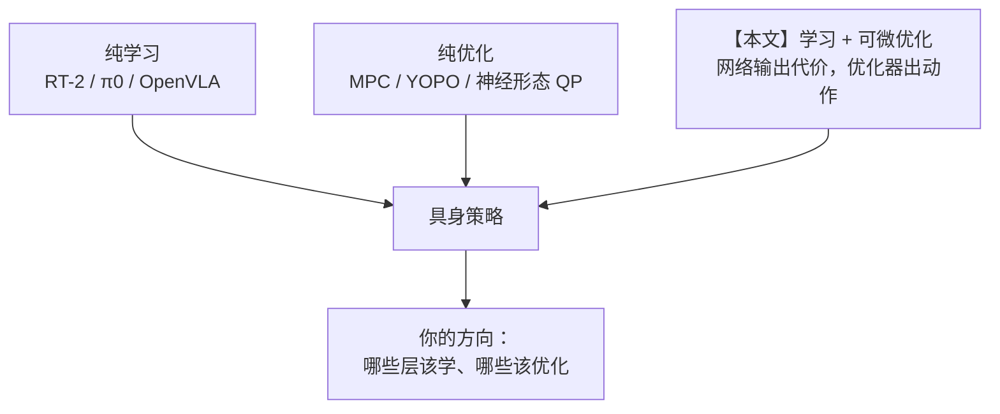

# P017 · 科研启发与复现建议

> 证据分级：**【原文证明】** / **【合理推测】** / **【待验证】**。
> 导航：[[Paper_017_ACMPC/01_论文精读|01 精读]] ｜ [[Paper_017_ACMPC/02_核心创新与方法|02 创新]] ｜ [[Paper_017_ACMPC/03_架构图与流程图|03 图]] ｜ [[Paper_017_ACMPC/04_术语和公式解释|04 术语]]

---

## 一、它在你的研究地图里的位置：第五条"算法范式"的收尾

**它的独特价值**：这是 24 篇里**唯一一篇把"可微优化"作为网络一层的**。它回答了一个我一直在追的问题：**学习与优化应该怎么分工？**

---

## 二、A–H 八问

### A. 对 VLA 推理加速的启发

**【原文证明】**
1. 每步要解一次 QP → 比纯前向慢。
2. 但 RTI 让它能实时（具体频率未给）。

**【合理推测】一个反向的启发**
> **AC-MPC 是"用计算换鲁棒性"的典型**：它比纯 RL 多了一层优化，因此更慢，但更稳。
> 而我现在读的 VLA 加速论文，大多在"用近似换速度"。**这两者是同一个 trade-off 的两端。**
>
> 对加速研究的启示：**如果一个系统的"安全感"来自某一层（如 MPC、如动作块），那么加速时最该保护的也是那一层。**

**【待验证】**：VLA 里有没有类似的"安全层"？（可能是动作块的平滑性、可能是碰撞检查）

### B. 对动作分块 / 执行调度的启发

**【原文证明】**
1. AC-MPC **没有动作块**——每步解一次 MPC。
2. 它的"预测"体现在 MPC 的 horizon 内，而不是输出一段动作。

**【合理推测】两种"前瞻"是不同的东西**
| 类型 | 机制 | 优点 | 缺点 |
|---|---|---|---|
| 动作块 | 一次输出多步，开环执行 | 摊薄推理 | 开环漂移 |
| MPC horizon | 每步优化时看向未来 N 步 | 闭环 | 每步都要算 |

> **AC-MPC 用"每步重算 + 内部前瞻"替代了"输出动作块"**。这提示我：**前瞻有两种实现方式——"输出侧的前瞻"（动作块）和"优化侧的前瞻"（MPC）**，它们可以互换。

### C. 对量化、缓存、压缩的启发

**【原文证明】**：本文没做量化，但"对角矩阵最好"说明**参数化越受约束越容易学**。
**【合理推测】**：这与量化/剪枝的"结构化先验"是同一逻辑——**给模型更强的结构约束，往往比给它更多参数更有效**。

### D. 是否能用于轮式双臂机器人？

**【原文证明】**：只在无人机上验证。
**【合理推测】**：
- 轮式双臂的 MPC 也是 QP（P016 就是），所以"可微 MPC 作为一层"**理论上可行**；
- 难点：机械臂的接触/抓取有**不可微**的部分（接触切换），需要额外处理；
- **可能的折中**：只对"自由空间运动"用可微 MPC，接触阶段用学习策略。

**【待验证】**。

### E. 是否需要真实硬件？

| 目标 | 需求 | 可行性 |
|---|---|---|
| 复现仿真 | 无人机仿真器 + 开源代码 | ✅ **可行**（代码已开源） |
| 复现真机 | 四旋翼 + 动捕 | ❌ 高 |

### F. 能否在仿真中先复现？

**【原文证明】**：代码开源（acmpc_public）。
**【我的判断】**：这是 24 篇里**代码可得性最好的之一**（另一个是 YOPO、OpenVLA、Diffusion Policy）。

### G. 本科阶段能否完成小规模实验？

**【我的判断】能，但建议换平台**：

> **题目**：在一个简单系统（倒立摆/小车）上，对比"网络直出控制"与"网络出代价 + 可微 MPC"，测分布外鲁棒性。

- 变量：是否经过优化层；
- 指标：分布内性能、分布外成功率；
- 预期：【合理推测】优化层会显著改善分布外。

### H. 博士阶段能否进一步拓展？

三条线：
1. **"哪一层该学、哪一层该优化"的一般性研究**；
2. **不可微动力学下的可微优化**（接触、碰撞）；
3. **Hessian 分析作为诊断工具**：用它看"RL 到底学到了什么"。

---

## 三、四个可落地的研究点

### 研究点 #1：把"可微 MPC"思想搬到机械臂

| 项目 | 内容 |
|---|---|
| **动机** | 本文只在无人机上验证 |
| **假设** | 机械臂的"自由空间运动"可以用可微 MPC，接触阶段切换到学习策略 |
| **设计** | 两阶段：接近用可微 MPC，接触用 VLA/RL；对比纯 VLA |
| **指标** | 成功率、末端精度、碰撞率 |
| **风险** | 接触不可微，切换点难设计 |

### 研究点 #2：VLA 的"安全层"在哪里

| 项目 | 内容 |
|---|---|
| **动机** | 见 A：加速时要保护"安全感来源" |
| **设计** | 在 VLA 后面加不同"安全层"（动作限幅/碰撞检查/平滑滤波），测加速后的鲁棒性 |
| **指标** | 成功率 vs 加速比 |
| **价值** | 把 AC-MPC 的"优化层"思想用于 VLA |

### 研究点 #3：Hessian 作为诊断工具

| 项目 | 内容 |
|---|---|
| **动机** | 本文用 Hessian 分析 critic 与代价的关系 |
| **设计** | 用 Hessian 分析 VLA 的价值头/动作头，看"它学到了什么形状" |
| **价值** | 一种新的可解释性工具 |

### 研究点 #4："输出代价"vs"输出动作"的普适对比

| 项目 | 内容 |
|---|---|
| **动机** | 这是本文最核心的设计选择 |
| **设计** | 在同一任务上，对比两种输出形式的样本效率、分布外鲁棒性、推理延迟 |
| **指标** | 三者 |
| **价值** | 给出"什么时候该输出代价"的判断标准 |

---

## 四、一个具体案例：侧风下穿过门（原文场景）

> [!warning] 案例性质
> 强风扰动是**原文的表 I 实验**（11.5 N，1.5× 自重）。下面的时间线是**教学示例**。

**场景**：无人机以 10 m/s 飞向门，突然受到 1.5 倍自重的横向风。

| 控制器 | 会发生什么 |
|---|---|
| **AC-MLP** | 没学过风 → 输出一个"正常"的姿态指令 → 被吹偏 → 撞门 |
| **跟踪 MPC** | 知道有风，但要跟踪一条"时间最优轨迹" → 轨迹本身要求极限机动 → 追不上 → 失败 |
| **L1-MPC** | 自适应估计扰动 → 能部分补偿 → 41.66% 通过 |
| **AC-MPC** | 网络输出"应对风"的代价（比如更重视横向位置误差），MPC 在动力学内求解 → 83.33% 通过 |

**关键理解**：AC-MPC 的优势不是"算得更准"，而是**"它有两个可以调的东西"**：
- 网络提供"任务层面的意图"（代价）；
- MPC 提供"物理层面的可行解"。

**两者叠加，比只有其中一个更鲁棒。**

---

## 五、复现路线

---

## 六、复现时会踩的坑

| 坑 | 说明 | 建议 |
|---|---|---|
| **N 与 RTI 迭代数未给全** | 影响精度与速度 | 从代码默认值开始 |
| **可微 MPC 的实现** | 需要 QP 求解器的可微版本 | 用现成库（如 Cvxpylayers/qpth） |
| **对角 vs 全矩阵** | 对角更好但表达力弱 | 先对角，再试 Cholesky |
| **MPVE 的 H** | 与 MPC horizon 对齐 | 先设 H=N |
| **扰动只在测试** | 训练时不加噪声 | 别在训练时加，否则结论失效 |
| **Hessian 分析** | 需要二阶导 | 用自动微分 |

---

## 七、与前后论文的关系

| 论文 | 关系 |
|---|---|
| [[00_文献总索引#P016 Neuromorphic QP MPC]] | 都是 MPC；那篇换硬件，这篇换"代价怎么来" |
| [[00_文献总索引#P014 You Only Plan Once]] | 都用"优化 + 学习"：YOPO 用梯度监督网络，本文用网络生成代价 |
| [[00_文献总索引#P006 Diffusion Policy]] | 都是"生成式策略"；DP 生成动作，本文生成代价 |
| [[00_文献总索引#P002 SPAR]] | 都用 RL 做后训练：SPAR 恢复能力，本文优化代价 |
| [[00_文献总索引#P005 π0 (pi-zero)]] | 都是"端到端"；但 π0 没有显式优化层 |

---

## 八、一句话总结对我的价值

> **这篇论文把"学习与优化怎么分工"这个问题回答得很干净：**让网络学"目标"（代价），让优化器学"怎么到达"（约束下的解）**。**
> 这个分工的好处是：**在分布外，"优化器"那一层成了最后的保险**——表 I 的 83.33% vs 41.66% 就是它的代价。
> 而它最漂亮的一句话是"AC-MPC 的优势**不以性能为代价**"——这在一个"要么快要么稳"的领域里，是很难得的结论。
