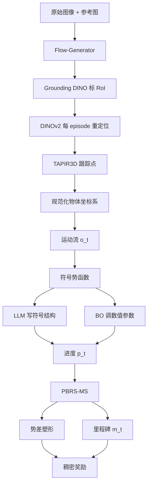
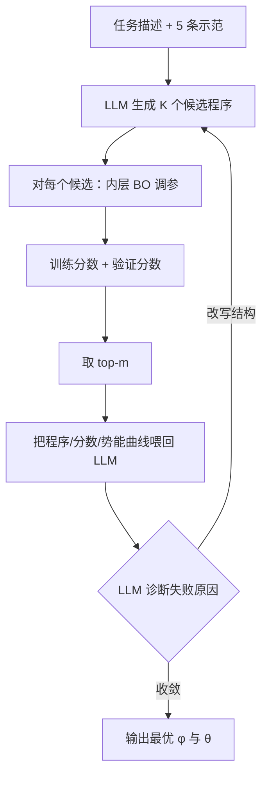
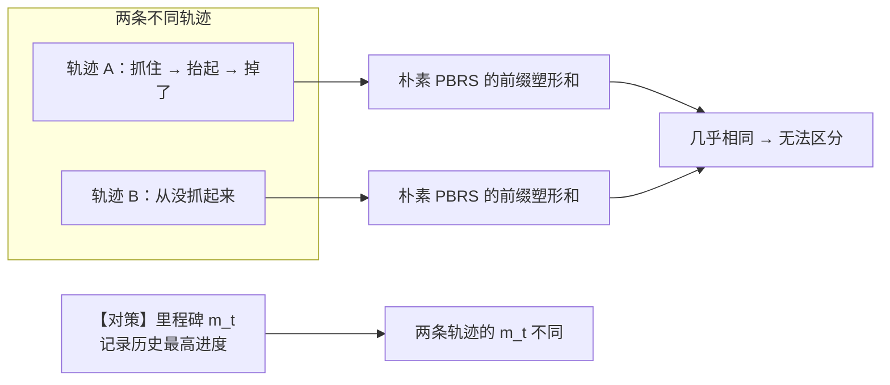
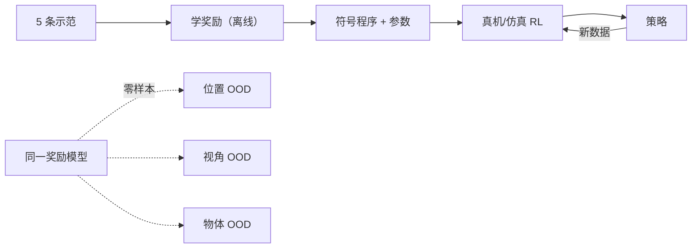
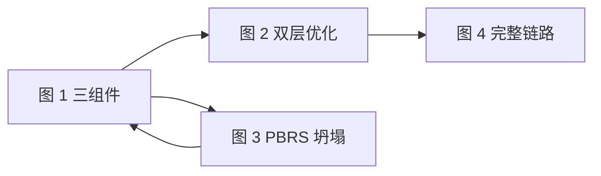

# P018 · 架构图与流程图

> 本文共 4 张图：
> **图 1 三个组件的结构** ／ **图 2 双层优化流程** ／ **图 3 PBRS 的"势能坍塌"问题** ／ **图 4 从示范到 RL 的完整链路**
> 每张图后附：逐节点解释 → 数据流 → 核心创新位置 → 原文出处。
>
> 导航：[[Paper_018_FLORA/01_论文精读|01 精读]] ｜ [[Paper_018_FLORA/02_核心创新与方法|02 创新]] ｜ [[Paper_018_FLORA/04_术语和公式解释|04 术语]] ｜ [[Paper_018_FLORA/05_科研启发与复现建议|05 启发]]

---

## 图 1 · 三个组件的结构

### 1.1 逐节点解释

| 节点 | 说明 |
|---|---|
| B | **换表示**：把像素换成物体相对运动 |
| C | **换形式**：把网络换成符号程序 |
| D | **换塑形**：PBRS + 里程碑 |

### 1.2 数据如何流动

图像 → 运动流 → 进度 → 奖励。

**关键在于第一段**：如果运动流本身不具备不变性，后面全白搭。

### 1.3 核心创新在哪

**B4（规范化物体坐标系）**——这是"不变性"的物理来源。

### 1.4 原文出处

图 2(a)、图 3、§IV-A。

---

## 图 2 · 双层优化流程

### 2.1 逐节点解释

| 节点 | 说明 |
|---|---|
| C | 内层：BO + UCB 采集函数 |
| E | 双层筛选：训练集防过拟合、验证集选泛化 |
| F | **反思材料**：不只给分数，还给势函数轨迹图 |

### 2.2 为什么这样分层

- **符号层**是离散的（写什么代码）→ 用 LLM（擅长离散）；
- **数值层**是连续的（阈值多少）→ 用 BO（擅长低维连续）。

### 2.3 原文出处

图 5、§V-D。

---

## 图 3 · PBRS 的"势能坍塌"问题

### 3.1 逐节点解释

| 节点 | 说明 |
|---|---|
| T1 | 有进展也有回退 |
| T2 | 完全没进展 |
| R | telescoping 导致"只看终点"，中间的进展被抵消 |

### 3.2 为什么重要

这解释了**为什么不能直接把 PBRS 用在操作任务上**——长时任务里"回退"很常见，朴素塑形会把"努力过"和"没努力"混为一谈。

### 3.3 原文出处

§IV-C（PBRS-MS 一节）。

---

## 图 4 · 从示范到 RL 的完整链路

### 4.1 逐节点解释

| 节点 | 说明 |
|---|---|
| B | 全离线，无在线交互 |
| C | 输出是"程序"，可读可改 |
| G/H/I | **同一个奖励模型**不重训就迁移 |

### 4.2 数据如何流动

示范 → 奖励 → RL → 策略；奖励本身可复用到 OOD 场景。

### 4.3 原文出处

图 1、§VI。

---

## 五、四张图的关系

---

## 六、自检：哪些是原文有，哪些是我补的

| 元素 | 性质 |
|---|---|
| 三组件、PBRS-MS、里程碑公式 | 【原文·§IV、图 2】 |
| 双层优化流程 | 【原文·§V、图 5】 |
| 表 I 数字 | 【原文·表 I，已核对接图】 |
| 图 3 的"两条轨迹"对比 | 【我的可视化】，逻辑来自 §IV-C 的文字 |
| 图 4 的"零样本复用" | 【原文·图 1(c)】 |
| §VI-B/C/D 的细节 | ⚠️ **未核实**（未读该页） |
