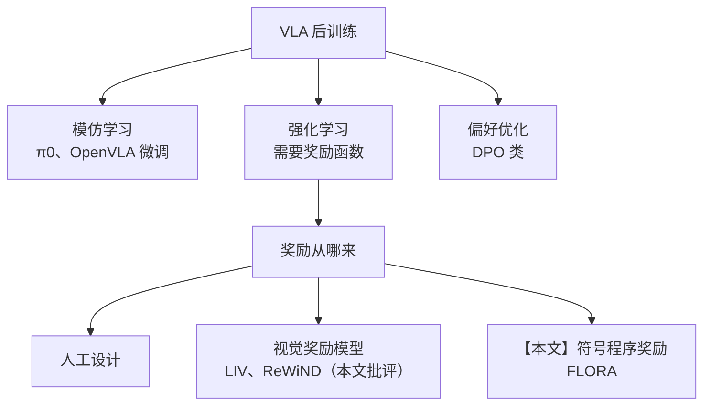

# P018 · 科研启发与复现建议

> 证据分级：**【原文证明】** / **【合理推测】** / **【待验证】**。
> 导航：[[Paper_018_FLORA/01_论文精读|01 精读]] ｜ [[Paper_018_FLORA/02_核心创新与方法|02 创新]] ｜ [[Paper_018_FLORA/03_架构图与流程图|03 图]] ｜ [[Paper_018_FLORA/04_术语和公式解释|04 术语]]

---

## 一、它在你的研究地图里的位置：VLA 的"另一条后训练路线"

**它的独特价值**：这是 24 篇里**唯一一篇专门研究"奖励从哪来"**的论文。而奖励恰恰是 VLA 做后训练时最缺的东西。

---

## 二、A–H 八问

### A. 对 VLA 推理加速的启发

**【原文证明】**：本文与加速无关。
**【合理推测】**：有一处间接相关——**FLORA 的奖励是"程序"而不是大模型**，所以**推理极轻**（几个算术比较）。这提示：
> **"把知识写进程序"比"把知识写进网络"便宜得多**（推理成本上）。
> 同理，VLA 的动作后处理如果用规则而非网络，也能省算力。

### B. 对动作分块 / 执行调度的启发

**【原文证明】**：本文不涉及动作块，奖励是**每帧**算的。
**【合理推测】**：奖励的"时间分辨率"（每帧 vs 每段）会影响塑形效果——这个维度在 VLA 里对应"每步打分 vs 每段打分"。

### C. 对量化、缓存、压缩的启发

**【原文证明】**：本文的奖励是符号程序，**天然不需要量化**。
**【合理推测】**：这是一个"用符号替代网络"的极端例子——**极端压缩就是不要网络**。

### D. 是否能用于轮式双臂机器人？

**【原文证明】**：真机是 Franka 单臂（Peg-Insert / Box-Open / Bulb-Unscrew）。
**【合理推测】**：轮式双臂的额外难点是"底盘运动也会产生运动流"——需要把底盘 RoI 也纳入跟踪。

### E. 是否需要真实硬件？

| 目标 | 需求 | 可行性 |
|---|---|---|
| 复现仿真 | Meta-World + 5 条示范 | ✅ **可行** |
| 复现真机 | Franka | ❌ 高 |
| 复现 LLM 部分 | 一个能写代码的 LLM | ✅ 容易 |

### F. 能否在仿真中先复现？

**【我的判断】**：**可以，而且这是 24 篇里"最小可复现"的之一**——奖励学习是离线问题，不需要真机，不需要大算力。

### G. 本科阶段能否完成小规模实验？

**【我的判断】非常适合**：

> **题目**：在 Meta-World 的 2–3 个任务上，对比三种奖励来源：① 手工稀疏奖励 ② 视觉相似度奖励（如 LIV 类） ③ 物体相对距离的程序奖励，测"OOD 位置/视角"下的排序正确性。

- 变量：奖励表示；
- 指标：进度对齐、排序；
- 成本：低（不需要训大模型）。

### H. 博士阶段能否进一步拓展？

三条线：
1. **奖励用于 VLA 后训练**（见下）；
2. **跨任务通用奖励**（本文是任务专用）；
3. **符号与网络的混合奖励**（程序给结构、网络给柔顺性）。

---

## 三、四个可落地的研究点

### 研究点 #1：用 FLORA 类奖励给 VLA 做后训练（我最推荐）

| 项目 | 内容 |
|---|---|
| **动机** | VLA 后训练缺奖励；FLORA 提供了"5 条示范 → 稠密奖励"的路径 |
| **设计** | 用 FLORA 学奖励 → 在仿真里对 VLA 做 RL 微调 → 对比模仿学习基线 |
| **指标** | 成功率、OOD 成功率 |
| **价值** | 把"奖励学习"与"VLA"接起来，**这是本文没做的** |

### 研究点 #2：奖励的"时间分辨率"

| 项目 | 内容 |
|---|---|
| **动机** | 本文每帧算奖励，VLA 通常每段算 |
| **设计** | 对比每帧 / 每 N 帧 / 每段打分的塑形效果 |
| **指标** | 样本效率 |
| **价值** | 直接决定奖励能否用于 VLA |

### 研究点 #3：跨任务通用奖励

| 项目 | 内容 |
|---|---|
| **动机** | 本文每任务要 5 条示范 |
| **设计** | 用一个任务学的程序，热启动另一个任务 |
| **指标** | 所需示范数 |
| **价值** | 逼近"通用奖励模型" |

### 研究点 #4：符号 + 网络的混合奖励

| 项目 | 内容 |
|---|---|
| **动机** | 程序表达逻辑强但柔顺性弱（接触力等连续量难写） |
| **设计** | 程序管"阶段判定"，网络管"接触质量" |
| **价值** | 兼顾可解释与表达力 |

---

## 四、一个具体案例：换了个杯子的"倒水"

> [!warning] 案例性质
> 下面**不是**原文的某个具体任务，而是**为理解"行为不变量"构造的教学示例**，基于原文的"位置/视角/物体 OOD"设定。

**场景**：机器人要把水从一个杯子倒进另一个杯子。训练时用的是白杯子，测试时换成红色杯子、位置偏了 20 cm、相机角度变了 30°。

| 奖励类型 | 会发生什么 |
|---|---|
| **视觉相似度奖励** | 训练时"白杯子在画面中央"得分高；测试时红杯子 → 分数乱 |
| **物体相对运动奖励（FLORA）** | 程序里写的是 `angle(cup_a, cup_b) > 60°` 和 `distance(spout, cup_b) < 0.05` → **与颜色无关、与位置无关** |

**关键理解**：
- **不变量不是"学"出来的，是"选"出来的**；
- 选对了表示（相对角度、相对距离），OOD 问题就消失了一大半。

---

## 五、复现路线

---

## 六、复现时会踩的坑

| 坑 | 说明 | 建议 |
|---|---|---|
| **PDF 是纯图像** | 无法直接抽取文本 | 渲染页面读（我就是这么做的） |
| **未开源** | 细节要猜 | 从论文描述的组件推断 |
| **依赖 TAPIR3D** | 3D 点跟踪器不易部署 | 仿真里可用真值位姿替代 |
| **LLM 写程序不稳定** | 输出格式、正确性 | 加语法校验与重试 |
| **指标实现** | Spearman、PBRS 正性 | 按式 (6)(7) 严格实现 |

---

## 七、与前后论文的关系

| 论文 | 关系 |
|---|---|
| [[00_文献总索引#P017 Actor-Critic MPC]] | 都涉及 RL；那篇用任务奖励，这篇解决"奖励从哪来" |
| [[00_文献总索引#P002 SPAR]] | 都用 RL 做后训练；SPAR 用 PPO 恢复能力，本文提供稠密奖励 |
| [[00_文献总索引#P010 DiPLO]] | 都是"用额外信号引导策略"：DiPLO 用特权信息，本文用符号奖励 |
| [[00_文献总索引#P007 SayCan]] | 都用 LLM 生成"可执行的结构"：SayCan 生成技能序列，本文生成奖励程序 |
| [[00_文献总索引#P021 VLA Survey (Ma)]] | 综述里会讨论奖励/后训练的位置 |

---

## 八、一句话总结对我的价值

> **这篇让我意识到：**泛化问题往往不是"模型不够大"，而是"表示选错了"**。**
> 表 I 里 LIV 零样本 −0.13 这个数字很刺眼——一个在 EpicKitchens 上预训练的视觉奖励模型，直接用在操作任务上**比随机还差**。而 FLORA 用 5 条示范就拿到 0.97。
> 另外，PBRS-MS 那段对我的启发是**理论工具的边界**：PBRS 保证了"最优策略不变"，但**没保证"中间过程可学"**——于是长任务里就出现了势能坍塌。**理论保证 ≠ 工程可用**，这是很值得记住的一课。
