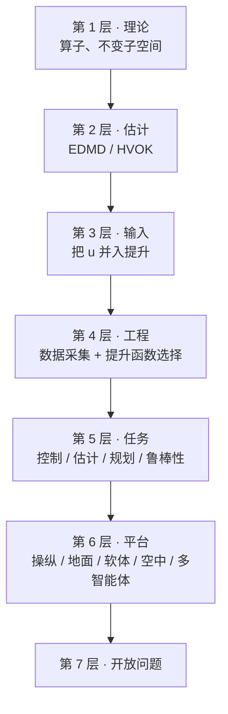
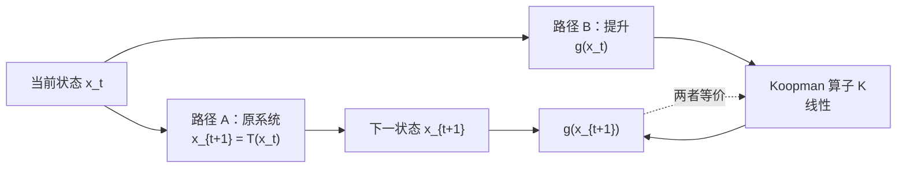
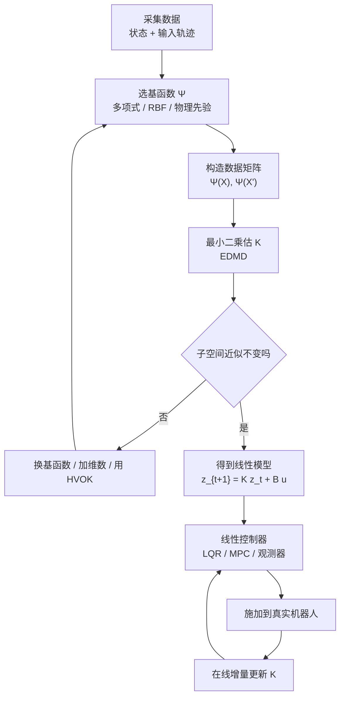
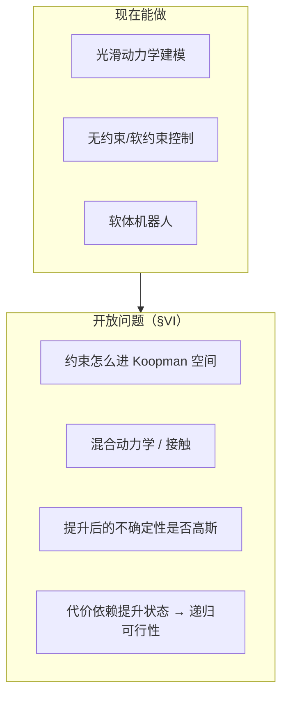
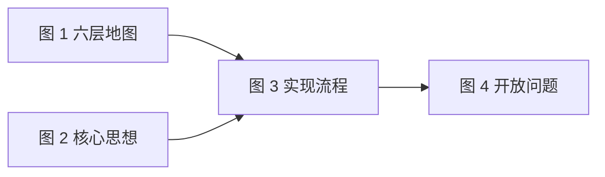

# P019 · 知识图谱与流程图

> 综述没有"系统架构"，所以本笔记画的是**知识结构**：
> **图 1 综述的六层地图** ／ **图 2 Koopman 的核心思想（两条路径）** ／ **图 3 从数据到控制的实现流程** ／ **图 4 开放问题与前缀技术**
> 每张图后附：逐节点解释 → 关系说明 → 对应原文章节。
>
> 导航：[[Paper_019_Koopman/01_论文精读|01 精读]] ｜ [[Paper_019_Koopman/02_核心创新与方法|02 框架]] ｜ [[Paper_019_Koopman/04_术语和公式解释|04 术语]] ｜ [[Paper_019_Koopman/05_科研启发与复现建议|05 启发]]

---

## 图 1 · 综述的六层地图

### 1.1 逐节点解释

| 层 | 内容 | 原文小节 |
|---|---|---|
| 1 | 式 (1)–(5) | §II-A |
| 2 | EDMD、HVOK | §II-B |
| 3 | 带输入系统 | §II-C |
| 4 | 数据与提升函数 | §III-A、§III-B |
| 5 | 控制器、估计、规划、鲁棒性 | §III-C–F |
| 6 | 五类平台 | §IV |
| 7 | 四条开放问题 | §VI |

### 1.2 为什么这样排

这是**实现顺序**，不是文献分类：一个人要真正把 Koopman 用起来，必须按 1→6 走一遍。

### 1.3 对应章节

§II–§VI。

---

## 图 2 · Koopman 的核心思想（两条路径）

### 2.1 逐节点解释

| 节点 | 含义 |
|---|---|
| 路径 A | 用非线性函数 $T$ 直接传播 |
| 路径 B | 先提升到可观测量，再用**线性算子**传播 |
| 等价性 | $Kg(x_t)=g(x_{t+1})$（式 3） |

### 2.2 这张图想说明什么

**两条路径结果相同，但路径 B 是线性的。**
这就是全部魔法的来源——**不是改变了系统，而是改变了"我们怎么观察它"**。

### 2.3 原文出处

图 2、式 (2)(3)。

---

## 图 3 · 从数据到控制的实现流程

### 3.1 逐节点解释

| 节点 | 说明 |
|---|---|
| B | **最关键的一步**（§III-B） |
| D | EDMD 的最小二乘 |
| E | 现实里永远只是"近似不变" |
| I | Koopman 支持**增量更新**——这是它适合在线学习的理由 |

### 3.2 数据如何流动

数据 → 基函数 → 矩阵 → 算子 → 控制器 → 机器人 → 新数据 → 更新。

### 3.3 核心环节在哪

**B（选基函数）**。综述花了整整一节讲它，说明它是实际成败的关键。

### 3.4 原文出处

§II-B、§III-A/B/C、§III-C。

---

## 图 4 · 开放问题与前缀技术

### 4.1 逐节点解释

| 问题 | 为什么现在做不到 |
|---|---|
| 约束 | 提升后的可行集可能非凸 |
| 接触 | 需要分段光滑，Koopman 假设光滑 |
| 不确定性 | 非线性提升不保持高斯性 |
| 代价设计 | 提升状态的代价缺乏物理意义 |

### 4.2 为什么这四条重要

**它们恰好是机器人最需要的四件事**：安全约束、接触、不确定性、可优化的目标。
→ 也就是说，**Koopman 目前最适合"光滑、无接触、约束宽松"的任务**。

### 4.3 原文出处

§VI。

---

## 五、四张图的关系

---

## 六、自检：哪些是原文有，哪些是我补的

| 元素 | 性质 |
|---|---|
| 两条路径、式 (2)(3) | 【原文·图 2、§II-A】 |
| EDMD / HVOK | 【原文·§II-B】 |
| 六层结构 | 【我的整理】，依据原文小节顺序 |
| 图 3 的循环（在线更新） | 【原文·§III-C 提到增量更新】，图是我画的 |
| 图 4 的四条开放问题 | 【原文·§VI】 |
| "最适合光滑无接触任务" | **【我的推论】**，原文没有这样总结 |
