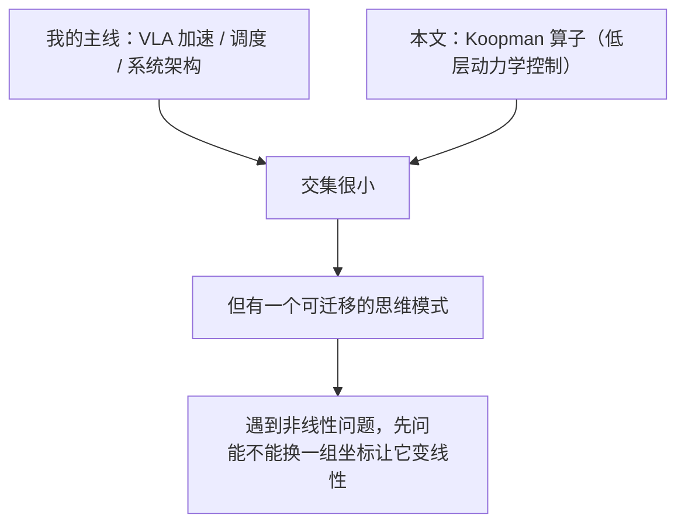

# P019 · 科研启发与复现建议

> 证据分级：**【原文证明】** / **【合理推测】** / **【待验证】**。
> 导航：[[Paper_019_Koopman/01_论文精读|01 精读]] ｜ [[Paper_019_Koopman/02_核心创新与方法|02 框架]] ｜ [[Paper_019_Koopman/03_架构图与流程图|03 图]] ｜ [[Paper_019_Koopman/04_术语和公式解释|04 术语]]

---

## 一、先说实话：这篇与我的主方向交集很小

**不强行建立联系**：这篇综述**没有涉及 VLA、没有涉及大模型、没有涉及触觉/多模态**。它的战场是"低层动力学控制"。

但它提供了**一个可迁移的抽象**，我在下面写清楚。

---

## 二、A–H 八问

### A. 对 VLA 推理加速的启发

**【原文证明】**：无关。Koopman 是控制层理论。
**【合理推测】有一个间接的启发**：
> **"换表示"比"换模型"更省算力。**
> Koopman 把非线性动力学换成"提升空间里的线性矩阵乘"——**一旦是线性的，推理就只是一个矩阵乘法**。
> 这与我在 P016（神经形态 QP）看到的是同一逻辑：**把难算的东西变成结构上简单的东西**。

**【待验证】**：VLA 的动作头能否用类似的"换表示"降低计算？（例如把扩散的 100 步换成线性算子的一次乘）

### B. 对动作分块 / 执行调度的启发

**【原文证明】**：Koopman 模型支持**增量更新**（摘要明确说 "incremental updates and low computational cost"），适合实时与在线学习。
**【合理推测】**：
> 在线更新一个矩阵 $K$ ≪ 在线微调一个网络。
> 这提示：**如果系统里有一个"可增量更新"的轻量模型，调度就可以更频繁**——因为更新成本低。

### C. 对量化、缓存、压缩的启发

**【原文证明】**：Koopman 的"模型"只是一个 $N\times N$ 矩阵。若 $N$ 不大（几十到几百），整个模型只有几万个参数。
**【合理推测】**：
> **"模型大小"本身可以是一种正则化**。Koopman 强制你用低维线性模型，因此**不会过拟合、也不需要量化**。
> 这与 SPAR（P002）"剪到很小还保持性能"形成有趣对照：一个靠剪枝，一个靠结构。

### D. 是否能用于轮式双臂机器人？

**【原文证明】**：综述 §IV 覆盖了操纵、地面、软体、空中、多智能体。
**【合理推测】**：轮式双臂的**底盘运动**适合 Koopman（光滑、低维）；**接触操作**不适合（§VI 明确说混合动力学是开放问题）。
**【结论】**：可以用于"移动"部分，不适合"接触"部分。

### E. 是否需要真实硬件？

| 目标 | 需求 | 可行性 |
|---|---|---|
| 跑教程代码 | 只需 Python | ✅ **极容易** |
| 复现某平台实验 | 对应机器人 | ❌ 高 |
| 做一个小课题 | 仿真（如 Gym 的连续控制） | ✅ 容易 |

### F. 能否在仿真中先复现？

**【我的判断】**：**这是 24 篇里"上手最快"的一篇**——配套代码开源、理论清晰、仿真任务现成。

### G. 本科阶段能否完成小规模实验？

**【我的判断】非常适合作为"理论学习 + 小实验"**：

> **题目**：在倒立摆/小车环境里，用 EDMD 从数据估一个 Koopman 模型，用它做 LQR 控制，对比"在工作点线性化"的 LQR，看**远离工作点时的性能差异**。

- 变量：线性化方式（局部 vs Koopman）；
- 指标：跟踪误差、稳定域；
- 成本：低。

### H. 博士阶段能否进一步拓展？

如果我做 VLA，**不建议把 Koopman 作为主线**（社区不同、评审不同）。
但可以做一个**交叉小点**：把 Koopman 作为"低层执行器模型"嵌到 VLA 的分层架构里（见下）。

---

## 三、四个可落地的研究点

### 研究点 #1：Koopman 作为 VLA 的"低层执行模型"（我最推荐）

| 项目 | 内容 |
|---|---|
| **动机** | VLA 输出动作，但"动作如何变成稳定运动"通常靠底层控制器；Koopman 可以给一个**可解析、可更新**的低层模型 |
| **假设** | 用 Koopman 模型替代 PID/ MPC 做底层，能让 VLA 的动作更平滑、对动力学变化更鲁棒 |
| **设计** | 分层：VLA 出高层目标 → Koopman-MPC 出低层控制；对比纯 PID 底层 |
| **指标** | 成功率、轨迹平滑度、对负载变化的鲁棒性 |
| **价值** | 把"学习高层 + 线性低层"这个组合做实；**这是 24 篇里没人做过的连接** |

### 研究点 #2：用 Koopman 做"动作平滑器"

| 项目 | 内容 |
|---|---|
| **动机** | VLA 的动作块常有抖动 |
| **设计** | 用 Koopman 模型对动作序列做"动力学一致化"投影 |
| **指标** | jerk、成功率 |
| **价值** | 轻量、可实时 |

### 研究点 #3：把"换表示"当作加速手段

| 项目 | 内容 |
|---|---|
| **动机** | 见 A：Koopman 的推理只是一个矩阵乘 |
| **设计** | 对比"扩散 100 步"vs"线性算子 1 次乘"在同一任务上的质量/延迟 |
| **价值** | 检验"线性化动作生成"的可行性 |

### 研究点 #4：约束的处理（跟 §VI 走）

| 项目 | 内容 |
|---|---|
| **动机** | 综述明确说"约束进 Koopman 空间"是开放问题 |
| **设计** | 试几种把盒约束映射到提升空间的方法，比较可行性 |
| **风险** | 偏理论，可能做不出来 |

---

## 四、一个具体案例：单摆的 Koopman 控制（教学示例）

> [!warning] 案例性质
> 下面**不是**原文的某个具体实验，而是**为理解原理构造的教学示例**，基于原文 §II 的理论。

**场景**：单摆，状态 $x=[\theta,\dot\theta]$，动力学 $\ddot\theta=-\frac{g}{L}\sin\theta$。

| 步骤 | 做什么 |
|---|---|
| 1 | 选基函数 $\Psi=[\theta,\ \dot\theta,\ \sin\theta,\ \cos\theta,\ \dot\theta\cos\theta,\dots]$ |
| 2 | 采数据：随机初始状态，仿真若干步，记录 $(x_t,x_{t+1})$ |
| 3 | EDMD：解 $K=\Psi(X')\Psi(X)^+$ |
| 4 | 得到线性模型 $z_{t+1}=Kz_t$ |
| 5 | 在 $z$ 空间设计 LQR |
| 6 | 施加到真实/仿真单摆 |

**关键理解**：
- 单摆的"摆动"在 $\theta$ 空间是非线性的，但在 $(\sin\theta,\cos\theta)$ 空间里是**旋转**——旋转是线性的；
- **这就是"换表示让问题变线性"的最直观例子**。

---

## 五、复现路线

---

## 六、复现时会踩的坑

| 坑 | 说明 | 建议 |
|---|---|---|
| **基函数选太少** | 模型不准 | 从多项式 2–3 阶开始 |
| **基函数选太多** | 过拟合 + 数值不稳 | 加正则（EDMD 的 ridge 变体） |
| **数据激励不足** | 某些区域没数据，$K$ 在那边不可信 | 用随机/正弦激励 |
| **§II-C 公式未精读** | 输入形式有多种 | 回原文核对再实现 |
| **可控性/可观性** | 提升后可能不可控 | 检查 $(K,B)$ 的可控性 |

---

## 七、与前后论文的关系

| 论文 | 关系 |
|---|---|
| [[00_文献总索引#P017 Actor-Critic MPC]] | 都是"用模型做控制"：那篇用可微 MPC，这篇用线性算子 |
| [[00_文献总索引#P016 Neuromorphic QP MPC]] | 都在"降低控制层计算"：一个换硬件，一个换表示 |
| [[00_文献总索引#P014 You Only Plan Once]] | 都用"结构化的低维表示"（基元 / 提升基）降低计算 |
| [[00_文献总索引#P006 Diffusion Policy]] | 对照：DP 用高维迭代生成，Koopman 用低维线性传播 |
| [[00_文献总索引#P020 Door-to-Door Parcel Delivery]] | 都是"系统级"工作，与 VLA 交集有限 |

---

## 八、一句话总结对我的价值

> **这篇与我的主线交集最小（这是我读的 19 篇里最"远"的一篇），但它给了一个我以后会反复用的提问方式：**
> **"这个非线性问题，能不能换一组坐标让它变线性？"**
> 在 VLA 里，这个问题可以变成："**动作生成的非线性，能不能用换表示消掉一部分？**"——如果扩散的 100 步能被一个线性算子的一次乘近似，那就是巨大的加速。
> 我也如实记下：**它的四个开放问题（约束、混合动力学、不确定性、代价设计）恰好覆盖了机器人最需要的四件事**——这说明 Koopman 目前最适合"光滑、无接触、约束宽松"的任务，而这恰好**不是**VLA 的主战场。
