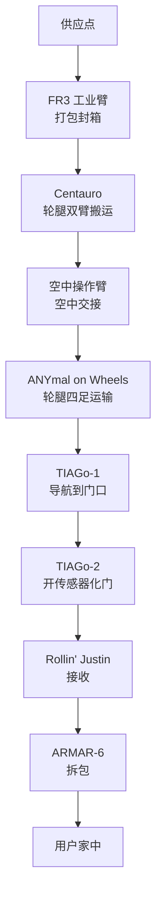
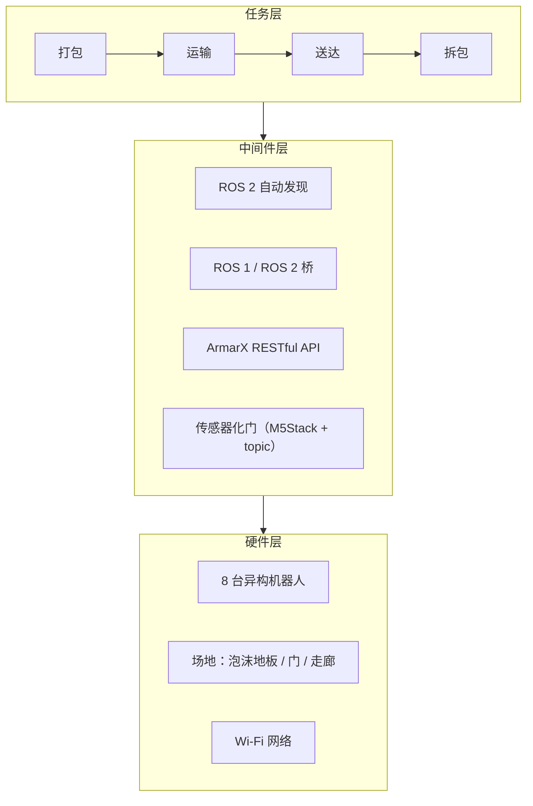
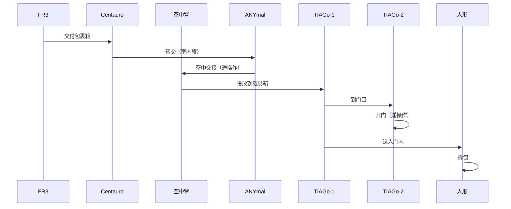
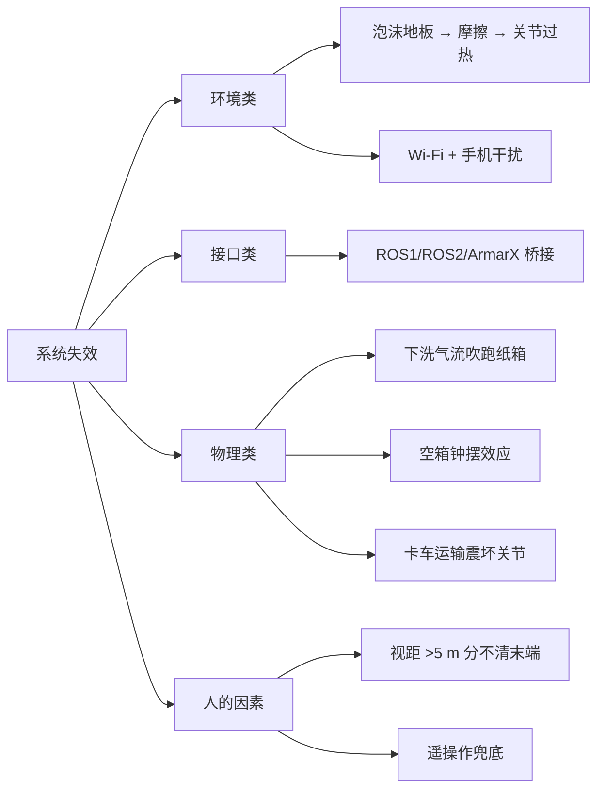
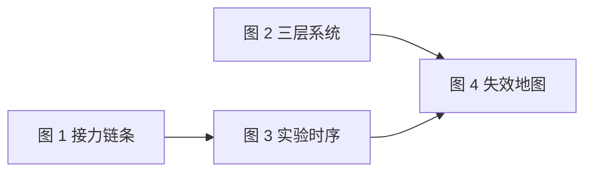

# P020 · 架构图与流程图

> 本文共 4 张图：
> **图 1 八机接力链条** ／ **图 2 三层系统（硬件 / 中间件 / 任务）** ／ **图 3 联合实验时序** ／ **图 4 失效模式地图**
> 每张图后附：逐节点解释 → 数据流 → 关键点 → 原文出处。
>
> 导航：[[Paper_020_EuROBIN/01_论文精读|01 精读]] ｜ [[Paper_020_EuROBIN/02_核心创新与方法|02 集成]] ｜ [[Paper_020_EuROBIN/04_术语和公式解释|04 术语]] ｜ [[Paper_020_EuROBIN/05_科研启发与复现建议|05 启发]]

---

## 图 1 · 八机接力链条

### 1.1 逐节点解释

| 节点 | 形态 | 负责 |
|---|---|---|
| R1 | 固定工业臂 | 抓取、装箱、封箱 |
| T1 | 轮腿 + 双臂 | 室内搬运 |
| T2 | 多旋翼 + 双臂 | 跨障碍交接 |
| T3 | 轮腿四足 | 跨障碍运输 |
| D1/D2 | 移动操作臂 | 导航、开门 |
| H1/H2 | 人形 | 接收、拆包 |

### 1.2 数据流（任务流）

包裹从供应点出发，经 8 台机器人交接，进入用户家中。

**关键**：这是一条**串行链**——任何一环失败，整条链断。这也是为什么"可靠性"比"单机性能"更重要。

### 1.3 关键点

**接力顺序不是随意的**：按"地形难度"排（室内 → 室外 → 门口 → 室内），让合适的形态做合适的一段。

### 1.4 原文出处

图 1、图 6、§Joint Experiment。

---

## 图 2 · 三层系统（我的整理）

### 2.1 逐节点解释

| 层 | 内容 | 关键问题 |
|---|---|---|
| 任务层 | 四个阶段 | 阶段之间的"交接"最难 |
| 中间件 | ROS2 / 桥 / REST / 传感器门 | 异构系统的粘合剂 |
| 硬件 | 机器人 + 场地 + 网络 | **真实的失效来源** |

### 2.2 这张图想说明什么

**大多数"系统论文"只画任务层和中间件层，而本文的教训几乎全在硬件层。**
（泡沫地板、下洗气流、Wi-Fi 干扰、卡车运输）

### 2.3 原文出处

§Scenario、§Platforms、§Lessons Learned（图是我按内容重组）。

---

## 图 3 · 联合实验时序

### 3.1 逐节点解释

| 交互 | 说明 |
|---|---|
| FR3→Centauro | 打包完成 |
| Centauro→ANYmal | 地面段交接 |
| ANYmal→空中臂 | **空中交接（遥操作）** |
| 空中臂→TIAGo-1 | 投放到载具箱 |
| TIAGo-2 开门 | **遥操作** |
| 人形拆包 | 最后一步 |

### 3.2 关键点

**两次遥操作都发生在"物理交接"处**：空中抓取、开门。
→ **物理接触越复杂，自主越难。** 这与我在 P012（Cracking MM）记的"接触丰富任务是难点"一致。

### 3.3 原文出处

§Joint Experiment、图 6、§结论。

---

## 图 4 · 失效模式地图

### 4.1 逐节点解释

| 类别 | 代表问题 |
|---|---|
| 环境 | 地板、网络 |
| 接口 | 中间件异构 |
| 物理 | 气流、负载、运输 |
| 人 | 遥操作的人因限制 |

### 4.2 这张图想说明什么

**四类失效里，只有"接口类"是软件问题**；其余三类都是"真实世界"的问题。
→ **做具身系统，软件只占一半。**

### 4.3 原文出处

§Lessons Learned 各段。

---

## 五、四张图的关系

---

## 六、自检：哪些是原文有，哪些是我补的

| 元素 | 性质 |
|---|---|
| 8 台机器人与分工 | 【原文·§Platforms、图 1】 |
| ROS2 / 桥 / REST / 传感器门 | 【原文·§Scenario】 |
| 18 分钟、两处遥操作 | 【原文·§结论】 |
| 各条教训 | 【原文·§Lessons Learned】 |
| 图 1 的编号 [1]–[8] | **【我的编号】** |
| 图 2 的三层结构 | **【我的整理】** |
| 图 3 的时序 | 依 §Joint Experiment 重画 |
| 图 4 的四类分类 | **【我的归纳】** |
| 表 3 逐任务时间 | ⚠️ 未核对 |
