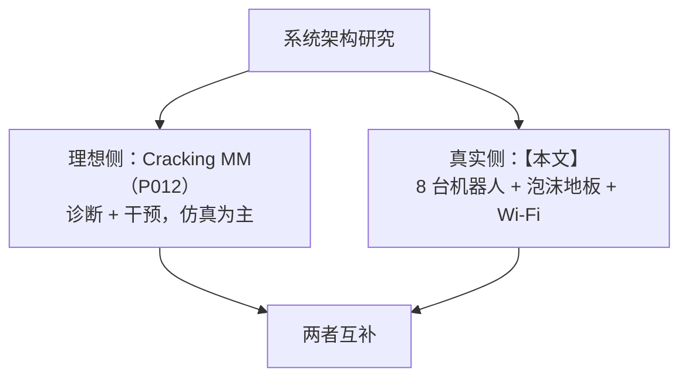

# P020 · 科研启发与复现建议

> 证据分级：**【原文证明】** / **【合理推测】** / **【待验证】**。
> 导航：[[Paper_020_EuROBIN/01_论文精读|01 精读]] ｜ [[Paper_020_EuROBIN/02_核心创新与方法|02 集成]] ｜ [[Paper_020_EuROBIN/03_架构图与流程图|03 图]] ｜ [[Paper_020_EuROBIN/04_术语和公式解释|04 术语]]

---

## 一、它在你的研究地图里的位置：系统架构的"真实世界版"

**它的独特价值**：我读的 20 篇里，**只有这一篇的失败原因主要是"物理世界"而不是算法**。

---

## 二、A–H 八问

### A. 对 VLA 推理加速的启发

**【原文证明】**：本文不涉及加速。
**【合理推测】一个间接但重要的启发**：
> 本文最慢的是**操作类任务**，作者明确说"需要提升执行速度，尤其是操作"。
> 而 VLA 正是"操作"这条线上的技术。
> **所以"操作慢"是真实系统的公认痛点**——这为 VLA 加速研究提供了来自系统集成的需求侧证据。

**【待验证】**：VLA 的推理延迟在**多机接力**场景下会被放大多少？（因为每一环都要等上一环）

### B. 对动作分块 / 执行调度的启发

**【原文证明】**：本文的系统是**任务级接力**，没有动作块的概念。
**【合理推测】**：
> 多机接力的"调度"比单机复杂得多：**每一环都是一个阻塞点**。
> 串行链的可靠度是各段可靠度的乘积——这就是为什么它们最终用了"遥操作兜底"。

### C. 对量化、缓存、压缩的启发

**【原文证明】**：无。
**【合理推测】**：无直接可迁移点。

### D. 是否能用于轮式双臂机器人？

**【原文证明】**：本文有两台移动操作臂（TIAGo-1/2）。
**【合理推测】**：**这是"轮式双臂在真实家居环境"的少数公开案例之一**。它的教训（导航到门口、开门、跟踪不可靠）对轮式双臂很直接。

### E. 是否需要真实硬件？

| 目标 | 需求 | 可行性 |
|---|---|---|
| 完整复现 | 8 台机器人 + 8 个团队 | ❌ 不可能 |
| 复现"两机接力" | 2 台移动操作臂 | ⚠️ 难 |
| 复现"接力协议" | 仿真多机 | ✅ 可行 |

### F. 能否在仿真中先复现？

**【合理推测】**：可以复现**协议层**（ROS2 接口、状态机、失败恢复），但**复现不了物理教训**（下洗气流、地板摩擦）。

### G. 本科阶段能否完成小规模实验？

**【我的判断】能做一个"缩小版"**：

> **题目**：在仿真里搭"两台移动操作臂接力搬箱子"的流程，实现状态机 + 失败重试 + 日志，统计每一段的耗时与失败率。

- 变量：有无重试机制；
- 指标：端到端时间、成功率；
- 价值：学会"系统集成"的基本功。

### H. 博士阶段能否进一步拓展？

一条我认为有价值的方向：
> **"把本文的教训形式化"**——例如：把"物理失效模式"（气流、地板、负载）建成一个**可测试的清单**，让系统在设计阶段就能自查。

---

## 三、四个可落地的研究点

### 研究点 #1：多机接力的可靠性建模（我最推荐）

| 项目 | 内容 |
|---|---|
| **动机** | 本文是串行链，任一环失败全链失败 |
| **假设** | 串行链的端到端成功率 ≈ 各段乘积；插入"冗余/重试"能显著提升 |
| **设计** | 仿真里对比：纯串行 / 加缓冲 / 加冗余机器人 |
| **指标** | 端到端成功率、时间 |
| **价值** | 把"系统集成"变成可计算的可靠性问题 |

### 研究点 #2：传感器化环境的设计原则

| 项目 | 内容 |
|---|---|
| **动机** | "把门变成会说话的设备"降低了难度 |
| **设计** | 系统比较"改造环境"vs"提升机器人能力"的成本/收益 |
| **价值** | 给真实部署提供决策依据 |

### 研究点 #3：遥操作兜底的"最小集"

| 项目 | 内容 |
|---|---|
| **动机** | 本文只在两处用了遥操作 |
| **假设** | 存在一个"最小遥操作集"，能让系统达到可接受可靠性 |
| **设计** | 逐环节替换自主/遥操作，测整体成功率 |
| **价值** | 给"渐进自主"提供路线图 |

### 研究点 #4：物理失效模式的检查表

| 项目 | 内容 |
|---|---|
| **动机** | 本文的坑（气流、地板、负载、Wi-Fi）都是可预见的 |
| **设计** | 整理成设计阶段的自查清单 + 对应测试 |
| **价值** | 工程性强，适合做工具 |

---

## 四、一个具体案例：空中交接为什么失败（原文事实）

> [!warning] 案例性质
> 下面的细节**来自原文 §Lessons Learned（空中团队）**，不是我编的；但时间线是我整理的教学化叙述。

**场景**：多旋翼 + 双臂要从桌上抓起纸箱，飞到轮腿四足上方投放。

| 尝试 | 发生了什么 | 原因 |
|---|---|---|
| 前 3 次 | 抓取失败 | **旋翼下洗气流**在 <1 m 距离把纸箱吹跑 |
| 后续 | 成功抓取 | 改用**力控**（Centauro 的双臂力控经验被借鉴） |
| 某次投放 | 失败 | 包裹是**空箱**（之前用 0.3 kg 负载），气流导致**钟摆效应** |

**关键理解**：
- **失败原因不是"抓不准"**，而是"机器人自己制造的风"；
- **负载变化会改变动力学**（空箱 vs 有载）；
- 作者的建议很具体：**加 FPV 相机**（>5 m 视距时人眼分不清末端与把手）。

---

## 五、复现路线

---

## 六、复现时会踩的坑

| 坑 | 说明 | 建议 |
|---|---|---|
| **没有 8 台机器人** | 无法完整复现 | 只复现协议层 |
| **物理教训难复现** | 气流/地板在仿真里不真实 | 用参数化扰动近似 |
| **误读"全自主"** | 原文用了遥操作 | 读结论原文 |
| **表 3 时间** | 我没核对 | 引用时注明 |

---

## 七、与前后论文的关系

| 论文 | 关系 |
|---|---|
| [[00_文献总索引#P012 Cracking Mobile Manipulation]] | 都是系统级：那篇在仿真里做诊断，这篇在真实场地做集成 |
| [[00_文献总索引#P011 MAVP]] | 都涉及移动操作；MAVP 解决"站哪"，本文解决"谁来做" |
| [[00_文献总索引#P019 Koopman Operators in Robot Learning]] | 都是"控制/系统"侧；交集小 |
| [[00_文献总索引#P007 SayCan]] | 都是"长程任务分解"；SayCan 是单机、本文是多机 |
| [[00_文献总索引#P024 Surface Mining Automation (Leung)]] | 都是"真实工业/野外场景的系统报告" |

---

## 八、一句话总结对我的价值

> **这篇让我看到"具身系统架构"最真实的一面：**系统失败的原因往往不是算法，而是地板、气流和 Wi-Fi。**
> 三条我会记住的：
> ① **改造环境可能比改造机器人便宜**（传感器化门）；
> ② **遥操作兜底不是失败，是工程上的合理折中**——关键是**诚实地说出来**；
> ③ **串行链的可靠性是乘积**，所以多机系统里"减少环节"比"提升单环"更有效。
