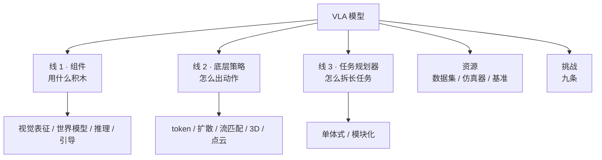
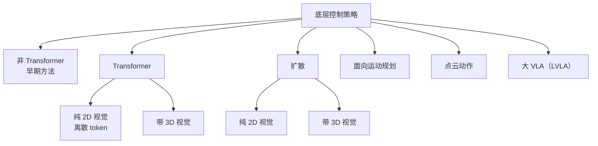
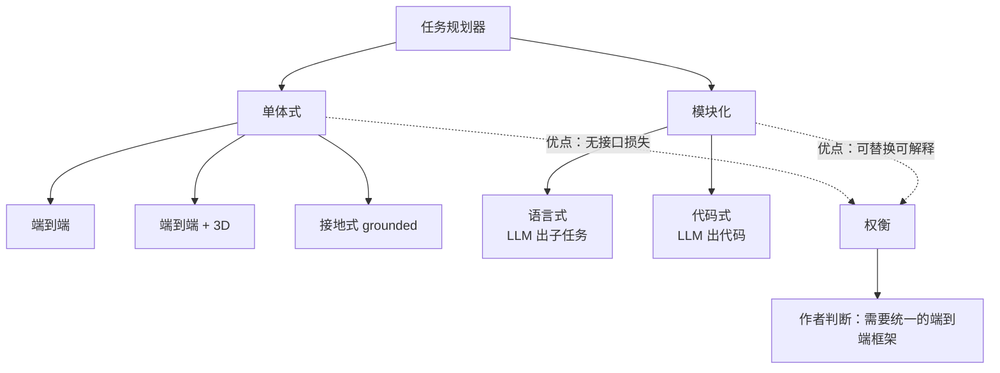
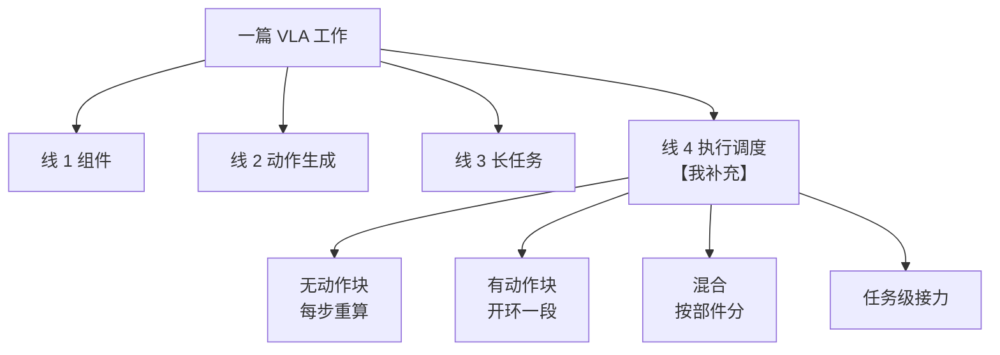
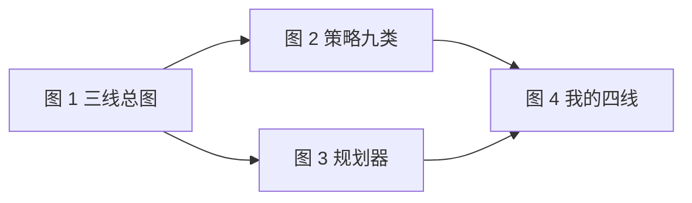

# P021 · 分类图谱

> 综述没有"系统架构"，所以本笔记画的是**分类图谱**：
> **图 1 三线体系总图** ／ **图 2 底层策略的九类** ／ **图 3 规划器的两条路** ／ **图 4 我的四线坐标（含自加的执行调度）**
> 每张图后附：逐节点解释 → 关系 → 对应章节。
>
> 导航：[[Paper_021_VLASurvey/01_论文精读|01 精读]] ｜ [[Paper_021_VLASurvey/02_核心创新与方法|02 分类体系]] ｜ [[Paper_021_VLASurvey/04_术语和公式解释|04 术语]] ｜ [[Paper_021_VLASurvey/05_科研启发与复现建议|05 启发]]

---

## 图 1 · 三线体系总图

### 1.1 逐节点解释

| 线 | 回答的问题 | 原文章节 |
|---|---|---|
| 线 1 | 用什么组件 | §III-A |
| 线 2 | 怎么出动作 | §III-B |
| 线 3 | 怎么拆长任务 | §IV |
| 资源 | 用什么数据/环境 | §V |
| 挑战 | 还缺什么 | §VI |

### 1.2 为什么三条线是正交的

一篇论文可以"用扩散策略（线 2）+ 世界模型组件（线 1）+ 模块化规划（线 3）"——三者不冲突。

### 1.3 对应章节

§III、§IV、§V、§VI。

---

## 图 2 · 底层策略的九类（线 2，我的主战场）

### 2.1 逐节点解释

| 分支 | 动作表示 | 我读过的代表 |
|---|---|---|
| C1 | 离散 token（256 bin） | RT-2（P003）、OpenVLA（P004） |
| C2 | token + 3D | —（我没读） |
| D1 | 连续去噪 | Diffusion Policy（P006）、TinyVLA（P001） |
| D2 | 去噪 + 3D | —（我没读） |
| E | 轨迹 | — |
| F | 点云 | — |
| G | 规模大 | π0 一类 |

> [!note] 一个分类上的观察
> **"扩散"与"Transformer"不是互斥的**：π0 用 Transformer 骨干 + 流匹配头，按这个分类它既像 C 又像 D。
> 这是我读综述时发现的一个**分类粒度问题**——见 02 笔记的疑点 3。

### 2.2 对应章节

§III-B。

---

## 图 3 · 规划器的两条路（线 3）

### 3.1 逐节点解释

| 类型 | 怎么做 | 我读过的代表 |
|---|---|---|
| 单体式 | 一个大模型直接规划 | — |
| 接地式 | 子任务接地到技能 | SayCan（P007）近似这一类 |
| 语言式 | LLM 出子任务文本 | SayCan（P007） |
| 代码式 | LLM 出可执行代码 | Cracking MM 的工具调用近似（P012） |

### 3.2 作者的关键判断

**分层最实用，但引入复杂度与延迟；单体式与 LVLA 冗余；模块式不即插即用 → 呼吁统一端到端框架。**

### 3.3 对应章节

§IV、§IV-C、§VI-e。

---

## 图 4 · 我的四线坐标（★自加第四条）

### 4.1 逐节点解释

| 线 4 取值 | 代表 | 占空比含义 |
|---|---|---|
| 无动作块 | RT-2、AC-MPC、MPC | ~100% |
| 有动作块 | DP、π0、TinyVLA | 9%–50% |
| 混合 | MAVP（臂用块、底盘走反馈） | 分部件 |
| 任务级接力 | Cracking MM、euROBIN | 任务级 |

### 4.2 为什么我要加这一条

**综述的三线没有覆盖"动作块/重规划频率/占空比"**——而这恰好是我读的 12 篇里反复出现的变量，也是我的研究兴趣所在。

> **综述的缺口 = 我的空间。**

### 4.3 出处

**线 4 是我的补充**，原文没有。

---

## 五、四张图的关系

---

## 六、自检：哪些是原文有，哪些是我补的

| 元素 | 性质 |
|---|---|
| 三线体系与子类 | 【原文·§III、§IV】 |
| 规划器优劣 | 【原文·§IV-C】 |
| 九条挑战 | 【原文·§VI】 |
| 图 4 的"线 4 执行调度" | **【我的补充】** |
| 20 篇的逐篇定位 | **【我的对照】**，见 02 笔记 |
| "分类粒度重叠"的批评 | **【我的观察】** |
