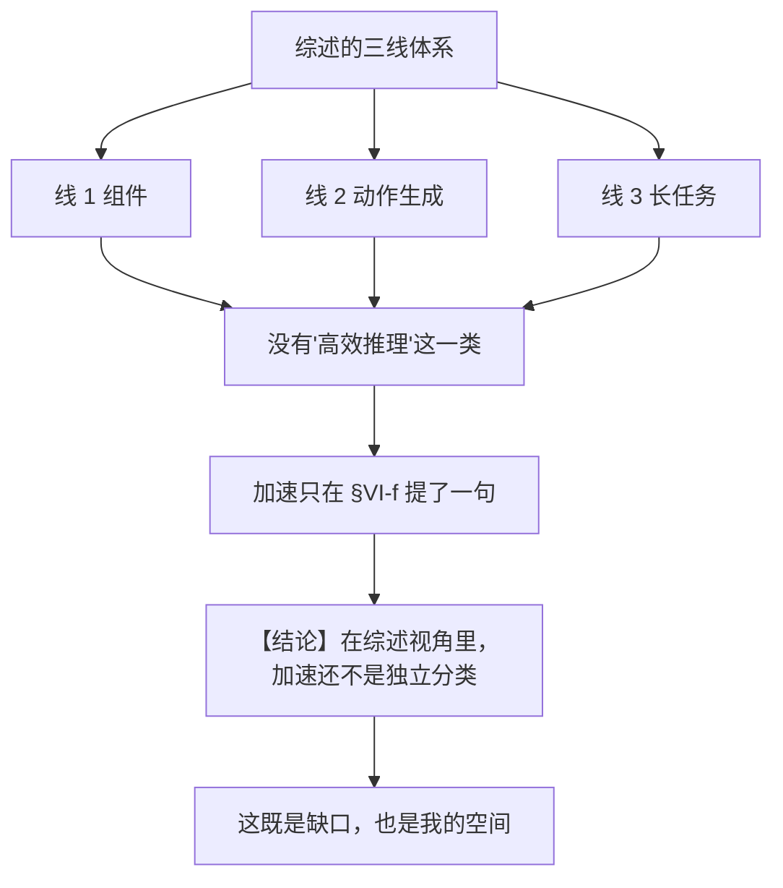

# P021 · 科研启发与复现建议

> 证据分级：**【原文证明】** / **【合理推测】** / **【待验证】**。
> 导航：[[Paper_021_VLASurvey/01_论文精读|01 精读]] ｜ [[Paper_021_VLASurvey/02_核心创新与方法|02 分类体系]] ｜ [[Paper_021_VLASurvey/03_架构图与流程图|03 图谱]] ｜ [[Paper_021_VLASurvey/04_术语和公式解释|04 术语]]

---

## 一、这篇综述对我最重要的一件事：它确认了"加速是缺口"

**【原文证明】**：9 类底层策略里**没有一类是"高效推理/加速"**；九条挑战里只有 f（实时响应）沾边。

**【合理推测】**：这说明 2024–2026 年，VLA 加速还没有被当成一个独立的研究维度——**我的方向是"新兴的细分领域"**，好处是空间大，风险是**还没有公认的评测标准**。

---

## 二、A–H 八问

### A. 对 VLA 推理加速的启发

**【原文证明】**（§VI-f，最有价值的一句）：
> "If inference time cannot keep pace with environmental changes, the model may generate **obsolete actions** repeatedly."

**【我的解读】** 这句话把"延迟"从工程指标变成了**正确性问题**：
- 慢不只是"慢"，而是**输出的动作已经与当前状态不匹配**；
- 所以加速研究的评价指标不该只是"延迟降低 X%"，而应该是"**在动态环境下成功率不降**"。

**【合理推测】** 这给了我一个可以写进论文动机的论点：
> **"VLA 加速的最终指标不是 FPS，而是在动态任务上的闭环成功率。**"

### B. 对动作分块 / 执行调度的启发

**【原文证明】**：综述**没有**把动作块/调度当成一个维度。
**【我的补充】**（见 02 笔记的"线 4"）：执行调度是第四条正交维度，可以用"占空比"量化：

| 系统 | 决策周期 | 占空比 |
|---|---|---|
| RT-2 | 每步 | ~100% |
| MPC（P016/P017） | 10 ms | ~100% |
| π0 | 0.5–0.8 s | 9% |
| DP | 每块 | ~50% |

**结论**：**动作块是"用开环换吞吐"的手段**，而占空比是它的量化指标。

### C. 对量化、缓存、压缩的启发

**【原文证明】**：综述对此着墨很少。
**【合理推测】**：这印证了我的判断——**压缩是"实现加速的手段"，不是"被综述承认的维度"**。这反而是机会：**把"压缩"与"调度"结合起来**（比如：量化后推理变快 → 可以用更小的动作块 → 闭环更好）可能是一个没人做过的角度。

### D. 是否能用于轮式双臂机器人？

**【原文证明】**：§VI-i 明确提到"dexterous hands, drones, quadruped robots, and humanoid robots"是未来方向。
**【合理推测】**：轮式双臂**没有单独被列出**，但它属于"移动操作"，是 P011/P012/P020 的共同平台——**这个组合在综述里是缺位的**。

### E. 是否需要真实硬件？

| 目标 | 需求 | 可行性 |
|---|---|---|
| 复现综述里的方法 | 看具体论文 | 差异大 |
| 用它的仓库找论文 | 只需浏览器 | ✅ 极容易 |

### F. 能否在仿真中先复现？

**不是复现对象**。但它的**资源清单（§V）是做实验的起点**：真实数据集、仿真器、基准。

### G. 本科阶段能否完成小规模实验？

**不能"复现综述"**，但可以：
> **题目**：按综述的三线分类，选 3–5 篇代表工作，在**同一个仿真基准**上比较它们的成功率与推理延迟。

- 价值：学会"横向对比"的基本功；
- 风险：复现别人的工作很难。

### H. 博士阶段能否进一步拓展？

**四条最值得做的（按其挑战排序）**：
1. **f 实时响应**：加速 + 动作块 + 动态环境的联合设计；
2. **e 长任务框架**：统一的端到端长任务（作者明确呼吁）；
3. **b 细粒度指标**：不止成功率的诊断指标；
4. **d 多模态**：触觉/音频（P013 是一个起点）。

---

## 三、四个可落地的研究点

### 研究点 #1：以"闭环成功率"为指标的加速评估（我最推荐）

| 项目 | 内容 |
|---|---|
| **动机** | 见 A：延迟是正确性问题，但现有加速论文多报 FPS/延迟 |
| **假设** | 有些加速方法在静态评测不掉点，但在动态环境掉点明显 |
| **设计** | 同一加速方法，在"静态任务"与"动态任务（移动目标/扰动）"上各测成功率 |
| **指标** | 成功率、延迟、**两者联合** |
| **价值** | 给加速研究一个更严格的协议；**这是综述 §VI-f 的直接延伸** |

### 研究点 #2：加速 × 动作块的联合优化

| 项目 | 内容 |
|---|---|
| **动机** | 加速变快 → 可以用更小的块 → 闭环更好；但小块也意味着更多次推理 |
| **假设** | 存在"加速比 × 块长"的最优点 |
| **设计** | 二维扫描：量化精度 × 块长 |
| **指标** | 成功率、端到端延迟 |
| **价值** | 把"压缩"与"调度"联系起来（综述没做） |

### 研究点 #3：细粒度诊断指标

| 项目 | 内容 |
|---|---|
| **动机** | §VI-b 明确说"需要成功率之外的指标" |
| **设计** | 借鉴 P012 的失败归因，做 VLA 的失败分类 |
| **价值** | 方法论价值高 |

### 研究点 #4：轮式双臂的 VLA 基准

| 项目 | 内容 |
|---|---|
| **动机** | 见 D：轮式双臂在综述里缺位 |
| **设计** | 建一个轮式双臂的移动操作基准（含导航+操作） |
| **风险** | 工程量大 |

---

## 四、一个具体案例：什么叫"过时动作"

> [!warning] 案例性质
> 下面是**为理解 §VI-f 构造的教学示例**，不是原文实验。

**场景**：机器人在传送带旁抓取移动的零件。

| 时刻 | 发生什么 |
|---|---|
| $t=0$ | 拍照，看到零件在位置 A |
| $t=0\text{–}800$ ms | 模型推理（π0 一类） |
| $t=800$ ms | 输出"抓 A 点"的动作块 |
| **但此时** | **零件已经移动到 B 点**（传送带 0.5 m/s × 0.8 s = 40 cm） |
| 结果 | 抓空 |

**关键理解**：
- 这不是"模型不准"，而是**模型输出的动作对应的是一个已经不存在的世界状态**；
- **加速的直接收益**：把 800 ms 压到 200 ms，零件只移动 10 cm，抓取成功率大幅提升；
- **这也解释了为什么 π0 要用动作块**：用"一次推理覆盖 0.8 s"来摊薄延迟——**但如果环境在 0.8 s 内变化很大，块反而有害**。

> **结论**：动作块与加速是**互补**的：加速减少"过时"，块长决定"能容忍多少过时"。

---

## 五、复现路线

---

## 六、复现时会踩的坑

| 坑 | 说明 | 建议 |
|---|---|---|
| **把综述当教程** | 它只分类，不教实现 | 配合具体论文读 |
| **版本差异** | arXiv v1（2024-05）与 TNNLS 版（2026）不同 | 用正式版 |
| **分类重叠** | 扩散与 Transformer 不互斥 | 按"动作表示"而非"骨干"分类 |
| **资源清单过期** | 2024 的基准可能已更新 | 查仓库最新 |

---

## 七、与前后论文的关系

| 论文 | 关系 |
|---|---|
| [[00_文献总索引#P003 RT-2]] | 综述称它是 VLA 一词的提出者 |
| [[00_文献总索引#P004 OpenVLA]] | 属于线 2 的"Transformer 策略" |
| [[00_文献总索引#P005 π0 (pi-zero)]] | 属于"流匹配"，综述里没有单独这一类（**分类缺口**） |
| [[00_文献总索引#P006 Diffusion Policy]] | 线 2 的"扩散策略" |
| [[00_文献总索引#P007 SayCan]] | 线 3 的"模块化 + 语言式/接地式" |
| [[00_文献总索引#P012 Cracking Mobile Manipulation]] | 线 3 的"模块化 + 工具调用" |
| [[00_文献总索引#P013 OmniVTLA]] | 线 1 的"多模态（触觉）" |
| [[00_文献总索引#P022 Dexterous Manipulation Survey (Li)]] | 另一篇综述，可交叉 |

---

## 八、一句话总结对我的价值

> **这篇综述给了我三样东西：一个坐标系（三线）、一个缺口清单（九条挑战）、一句我以后会反复引用的话——**
> **"如果推理跟不上环境变化，模型会反复生成过时的动作。"**
> 而我自己加了一条线（执行调度），因为**综述没覆盖它，而这恰好是我要做的方向**。
> 最后一点：它明确说"长任务需要统一的端到端框架"——**这句话是给未来博士生的邀请函**。
