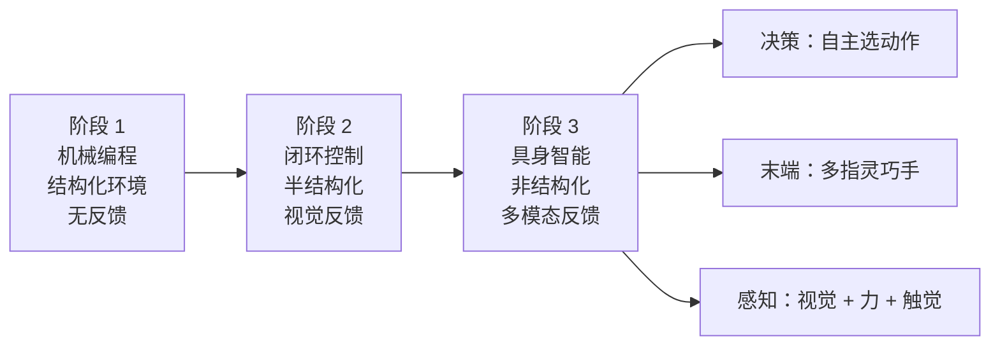
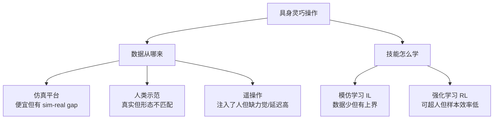
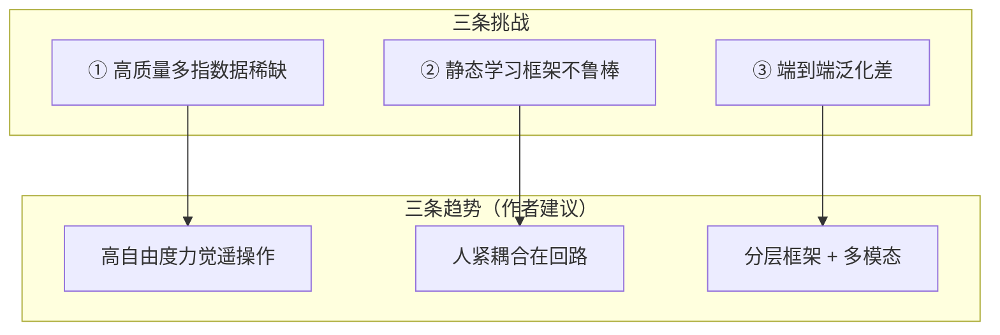
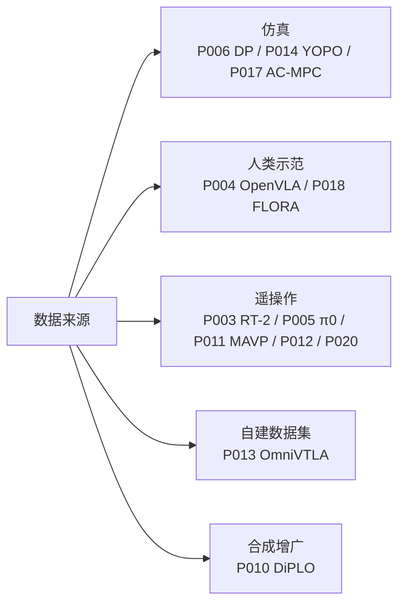
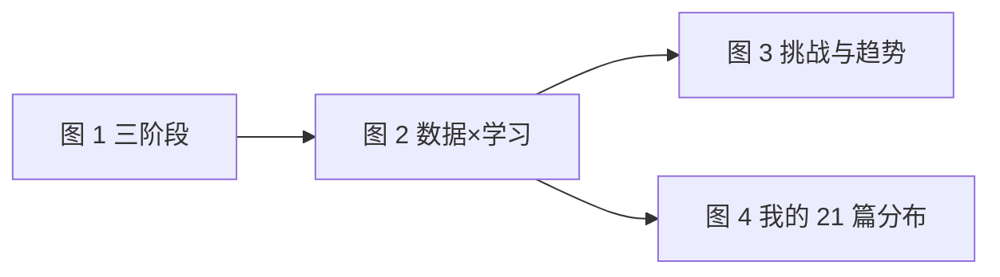

# P022 · 架构图与流程图

> 本文共 4 张图：
> **图 1 三阶段演进** ／ **图 2 数据 × 学习二维地图** ／ **图 3 三条挑战与三条趋势** ／ **图 4 我读过的 21 篇在数据维度上的分布**
> 每张图后附：逐节点解释 → 关系 → 对应章节。
>
> 导航：[[Paper_022_DexterousSurvey/01_论文精读|01 精读]] ｜ [[Paper_022_DexterousSurvey/02_核心创新与方法|02 框架]] ｜ [[Paper_022_DexterousSurvey/04_术语和公式解释|04 术语]] ｜ [[Paper_022_DexterousSurvey/05_科研启发与复现建议|05 启发]]

---

## 图 1 · 三阶段演进

### 1.1 逐节点解释

| 阶段 | 环境 | 反馈 | 依赖 |
|---|---|---|---|
| 1 | 结构化工厂 | 无 | 精确模型 + 预编程 |
| 2 | 半结构化 | 视觉 | 模型（如力封闭判据） |
| 3 | **非结构化** | **多模态** | 学习 + 数据 |

### 1.2 为什么这样分期

每个阶段的**环境复杂度**与**反馈丰富度**是同步上升的：
- 结构化 → 不需要反馈；
- 半结构化 → 视觉够；
- 非结构化 → 必须加力/触觉。

### 1.3 对应章节

§THE HISTORICAL STAGES。

---

## 图 2 · 数据 × 学习二维地图（本文核心框架）

### 2.1 逐节点解释

| 维度 | 取值 | 核心权衡 |
|---|---|---|
| 数据 | 仿真 / 人类 / 遥操作 | 真实度 vs 成本 vs 匹配度 |
| 学习 | IL / RL | 数据需求 vs 上界 |

### 2.2 为什么这张图有用

它把"任何一篇灵巧操作论文"都能定位：**（数据来源，学习方法）**。

例如：
- OmniVTLA（P013）= （自建真实数据集，IL/流匹配）；
- YOPO（P014）= （仿真，非学习）；
- FLORA（P018）= （5 条人类示范，IL + 下游 RL）。

### 2.3 对应章节

§数据采集范式、§学习框架。

---

## 图 3 · 三条挑战与三条趋势

### 3.1 逐节点解释

| 挑战 | 对应趋势 | 逻辑 |
|---|---|---|
| 数据稀缺 | 力觉遥操作采数据 | 解决"从哪来" |
| 静态不鲁棒 | 人紧耦合在回路 | 解决"怎么纠" |
| 泛化差 | 分层 + 多模态 | 解决"怎么组合" |

### 3.2 这张图想说明什么

**三条挑战与三条趋势是一一对应的**——作者不是随便列，而是"问题 → 解法"配套。

### 3.3 对应章节

§OPEN CHALLENGES AND NEW TRENDS。

---

## 图 4 · 我读过的 21 篇在"数据"维度上的分布（我的整理）

### 4.1 逐节点解释

| 类别 | 篇数 | 代表 |
|---|---|---|
| 仿真 | 3 | DP、YOPO、AC-MPC |
| 人类示范 | 2 | OpenVLA、FLORA |
| 遥操作 | 5 | RT-2、π0、MAVP、Cracking MM、euROBIN |
| 自建专用 | 1 | OmniVTLA |
| 合成/增广 | 1 | DiPLO |
| 未涉及数据 | 9 | 其余 |

### 4.2 这张图想说明什么

**21 篇里只有 4 篇真正处理"数据"**，而这恰好是综述指出的瓶颈。
→ **我的阅读重心（模型）与领域瓶颈（数据）存在偏差**——这是一个值得记下的自省。

### 4.3 出处

**图 4 是我根据前面笔记整理的，原文没有这张图。**

---

## 五、四张图的关系

---

## 六、自检：哪些是原文有，哪些是我补的

| 元素 | 性质 |
|---|---|
| 三阶段、三范式、IL/RL | 【原文】 |
| 三条挑战、三条趋势 | 【原文·§Open Challenges】 |
| 图 1 的"环境/反馈/依赖"三列 | 【原文·阶段图】的整理 |
| 图 2 的二维地图 | **【我的组织】**，原文分开讲两块 |
| 图 3 的"一一对应" | **【我的观察】**，原文分别叙述 |
| 图 4 | **【我的整理】**，原文没有 |
