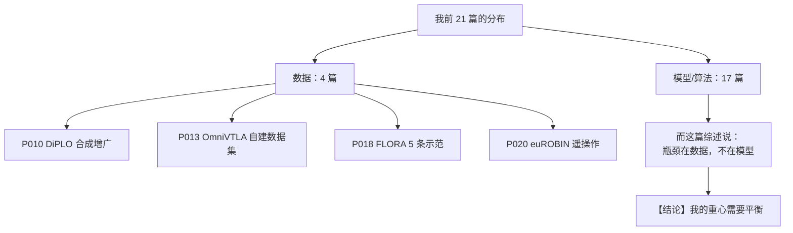

---
title: P022 灵巧操作综述（Li）科研启发与复现建议
paper_id: P022
short: Dexterous Survey
tags:
  - 科研启发
  - 灵巧操作
  - 数据
status: done
created: 2026-11-05
---

# P022 · 科研启发与复现建议

> 证据分级：**【原文证明】** / **【合理推测】** / **【待验证】**。
> 导航：[[Paper_022_DexterousSurvey/01_论文精读|01 精读]] ｜ [[Paper_022_DexterousSurvey/02_核心创新与方法|02 框架]] ｜ [[Paper_022_DexterousSurvey/03_架构图与流程图|03 图]] ｜ [[Paper_022_DexterousSurvey/04_术语和公式解释|04 术语]]

---

## 一、它给我的最大提醒：我的阅读重心偏了

**【原文证明】**：作者明确把"高质量多指数据稀缺"列为**第一条**开放挑战。

**【我的判断】**：这对我是个有用的纠偏——**我一直在读"模型怎么设计"，但领域真正的瓶颈在"数据从哪来"**。

---

## 二、A–H 八问

### A. 对 VLA 推理加速的启发

**【原文证明】**
1. 挑战 1 提到"**控制频率低（数十毫秒级），对精细操作太慢**"；
2. 遥操作系统"延迟常超过数十毫秒"。

**【合理推测】**：这两条把"延迟"与"灵巧操作"直接连起来了：
> **灵巧操作对延迟尤其敏感**——因为接触是瞬态的，几十毫秒的延迟就可能错过接触窗口。
> 这与 P021（VLA 综述）§VI-f 的"过时动作"是同一个问题的两面。

**【待验证】**：灵巧操作任务的"延迟容忍度"是多少？我推测在 **10–20 ms** 量级（远低于 VLA 的百毫秒级）。

### B. 对动作分块 / 执行调度的启发

**【原文证明】**：综述**没有**讨论动作块。
**【合理推测】**：
> 灵巧操作可能**不能用长动作块**：手内操作需要高频反馈调整，开环执行 0.8 s 可能已经把物体掉了。
> **这给"执行调度"加了一条约束：任务越"接触密集"，动作块必须越短。**

### C. 对量化、缓存、压缩的启发

**【原文证明】**：无。
**【合理推测】**：高自由度手的状态维度高（每指 3–4 关节 × 4–5 指），**动作空间本身就大**，量化压缩的空间也大——但精度要求也更高。

### D. 是否能用于轮式双臂机器人？

**【原文证明】**：综述讨论的是"多指灵巧手 + 机械臂"，没有专门讨论移动平台。
**【合理推测】**：轮式双臂 = 移动底盘 + 双臂，若末端换成灵巧手，就同时需要"移动"与"灵巧"，**难度叠加**。

### E. 是否需要真实硬件？

| 目标 | 需求 | 可行性 |
|---|---|---|
| 复现数据采集范式 | 灵巧手 + 遥操作系统 | ❌ 很贵 |
| 复现学习框架 | 仿真（如 Isaac/MuJoCo 手模型） | ✅ 可行 |
| 做"人在回路"实验 | 遥操作 + 干预接口 | ⚠️ 中 |

### F. 能否在仿真中先复现？

**【合理推测】**：可以。Isaac Gym / MuJoCo 都有灵巧手模型（Shadow Hand 等）。
**但要注意**：综述明确说"仿真有 sim-real gap"，所以**结论不能直接推到真机**。

### G. 本科阶段能否完成小规模实验？

**【我的判断】能，题目可以很干净**：

> **题目**：在仿真里（如 MuJoCo 的 Shadow Hand），对比"二值人类反馈"与"连续刚度信号"两种干预方式，看哪个学得更快。

- 变量：干预信号的类型；
- 指标：达到目标成功率所需的样本数；
- 价值：**直接验证综述挑战 2 的建议**。

### H. 博士阶段能否进一步拓展？

三条线（按综述的挑战排）：
1. **高频灵巧操作的数据采集**（力觉遥操作）；
2. **人在回路的连续干预**（刚度/力信号）；
3. **分层框架 + 灵巧手 + 触觉**（综述说这是缺口）。

---

## 三、四个可落地的研究点

### 研究点 #1：灵巧操作的"延迟-块长"约束（我最推荐）

| 项目 | 内容 |
|---|---|
| **动机** | 见 A/B：接触密集任务对延迟与块长都敏感 |
| **假设** | 存在"最大可容忍块长"，超过就掉物体；它随任务接触密度下降 |
| **设计** | 在仿真灵巧任务上扫块长（1/4/8/16/32 步），测成功率 |
| **指标** | 成功率 vs 块长 vs 延迟 |
| **价值** | 把"执行调度"与"灵巧操作"连起来，**这是我前面 4 条线里第 4 条的具体化** |

### 研究点 #2：连续干预信号 vs 二值反馈

| 项目 | 内容 |
|---|---|
| **动机** | 综述挑战 2 明确说二值反馈不够 |
| **设计** | 对比：无干预 / 二值 / 连续刚度 / 连续力 |
| **指标** | 样本效率、最终成功率 |
| **价值** | 直接验证综述的建议 |

### 研究点 #3：数据范式的成本-效果曲线

| 项目 | 内容 |
|---|---|
| **动机** | 综述说三种范式各有优劣，但**没量化** |
| **设计** | 同一任务，用三种范式各采 N 条数据，测下游性能 |
| **指标** | 性能/成本比 |
| **价值** | 给"该用哪种数据"提供依据（综述缺这个） |

### 研究点 #4：灵巧数据的"信息熵"度量

| 项目 | 内容 |
|---|---|
| **动机** | 综述说"信息熵低"但没给度量 |
| **设计** | 定义"有效样本率"（接触时刻占比），看它与下游性能的相关性 |
| **价值** | 方法论价值，且能指导数据采集 |

---

## 四、一个具体案例：为什么"人手示范"不能直接用

> [!warning] 案例性质
> 下面的形态差异是**原文 §人类示范 讨论过的事实**（如"某些手只有四指、驱动盒巨大"），但具体数字是我的教学化叙述。

**场景**：人用五指手拧瓶盖，动作被动捕记录下来，想教给一台四指灵巧手。

| 步骤 | 会发生什么 |
|---|---|
| 1 | 动捕得到人手的 21 个关节角轨迹 |
| 2 | **重定向**：映射到机器人的 16 个关节 |
| 3 | **问题 1**：人手拇指的对掌范围 > 机器人 → 某些姿势机器人做不到 |
| 4 | **问题 2**：机器人手掌后有驱动盒 → 某些接近角会碰撞 |
| 5 | **问题 3**：人手的接触力分布 vs 机器人指尖传感器 → 力反馈不可比 |
| 结果 | 需要**重新采集**或**大量修正** |

**关键理解**：**人-机形态差异不是"小误差"，而是"结构性不匹配"**——这也是为什么综述说"人类示范数据丰富但难转移"。

---

## 五、复现路线

---

## 六、复现时会踩的坑

| 坑 | 说明 | 建议 |
|---|---|---|
| **灵巧手模型难调** | 接触参数敏感 | 先用简单任务（转笔/拧盖） |
| **sim-real gap** | 综述明确警告 | 结论限定在仿真 |
| **遥操作设备贵** | 力觉设备价格高 | 用键盘/手柄代替，但注意信息损失 |
| **信息熵低** | 大部分帧没用 | 采样时聚焦接触时刻 |

---

## 七、与前后论文的关系

| 论文 | 关系 |
|---|---|
| [[00_文献总索引#P021 VLA Survey (Ma)|VLA 综述 (Ma)]] | 都分类；Ma 按"组件/策略/规划"，这篇按"数据/学习"——**两个正交的坐标** |
| [[00_文献总索引#P013 OmniVTLA]] | 那篇自建触觉数据集，正好回应本文"数据稀缺"的挑战 |
| [[00_文献总索引#P018 Beyond Pixels|FLORA]] | 那篇用 5 条示范学奖励，是"低数据"路线 |
| [[00_文献总索引#P020 Door-to-Door Parcel Delivery|euROBIN]] | 那篇的遥操作兜底，正是本文推荐的"力觉遥操作"的现实版 |
| [[00_文献总索引#P006 Diffusion Policy]] | 属于 IL 的深度方法 |

---

## 八、一句话总结对我的价值

> **这篇综述纠正了我的一个偏差：我一直在读"模型怎么做"，但它说瓶颈在"数据从哪来"。**
> 三个我会记住的判断：
> ① **灵巧操作对延迟极敏感**（数十毫秒就太慢）——这给加速研究提供了"最苛刻的场景"；
> ② **二值人类反馈丢掉了"程度"信息**，连续刚度信号可能是解；
> ③ **端到端在长任务上不行，要分层**——但分层 + 灵巧手 + 触觉还是空白。
