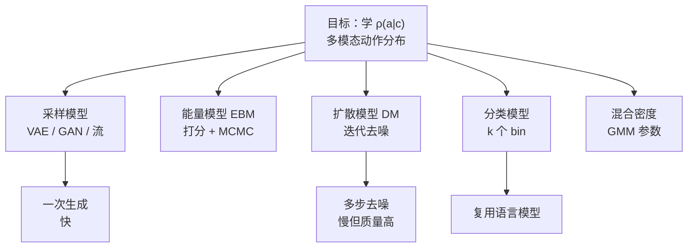
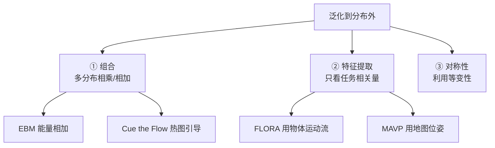
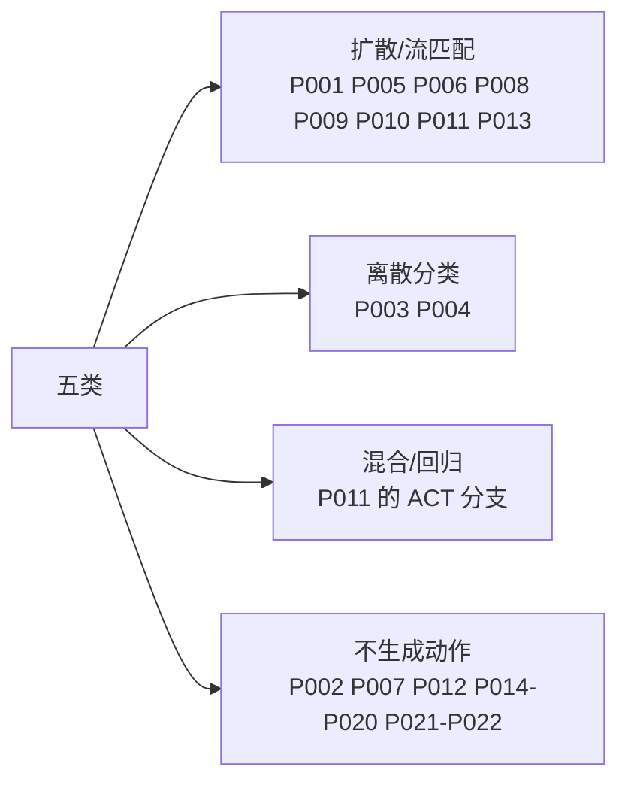
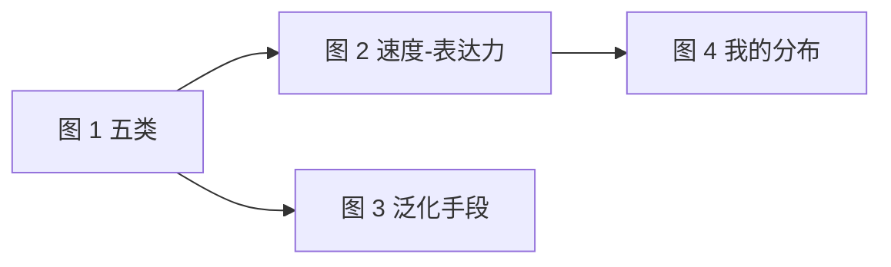

# P023 · 分类图谱

> 本文共 4 张图：
> **图 1 五类模型总图** ／ **图 2 表达力 vs 推理代价** ／ **图 3 三种泛化手段** ／ **图 4 我的 22 篇在五类中的分布**
> 每张图后附：逐节点解释 → 关系 → 对应章节。
>
> 导航：[[Paper_023_DGMSurvey/01_论文精读|01 精读]] ｜ [[Paper_023_DGMSurvey/02_核心创新与方法|02 对比]] ｜ [[Paper_023_DGMSurvey/04_术语和公式解释|04 术语]] ｜ [[Paper_023_DGMSurvey/05_科研启发与复现建议|05 启发]]

---

## 图 1 · 五类模型总图

### 1.1 逐节点解释

| 类别 | 怎么表示分布 | 怎么采样 |
|---|---|---|
| 采样模型 | 一个可逆/对抗/变分映射 | 噪声 → 一次前向 |
| EBM | 能量函数 | MCMC |
| 扩散 | 去噪链 | 迭代 |
| 分类 | $k$ 个概率 | 采一个 bin |
| 混合密度 | 混合参数 | 采一个成分 |

### 1.2 为什么用"密度估计"统一

**所有五类都在回答同一个问题**："给定观测和目标，动作应该服从什么分布？"
差别只在**用什么数学对象表示这个分布**。

### 1.3 对应章节

§III。

---

## 图 2 · 表达力 vs 推理代价（我的整理）

### 2.1 逐节点解释

| 位置 | 模型 | 推理代价 |
|---|---|---|
| 左端 | GMM | 一次前向 |
| | 分类 | 一次前向 + 采样 |
| | 采样模型 | 一次前向 |
| | 扩散 | 多步 |
| 右端 | EBM | MCMC（步数不定） |

### 2.2 这张图想说明什么

**这是一条结构性 trade-off**：想表达更复杂的多峰分布，就要付更多推理代价。
→ **我的加速研究就是"把曲线往左下推"**：用更少步数达到同样质量。

### 2.3 出处

**图 2 是我根据 §III 的特性描述整理的，原文没有这样画。**

---

## 图 3 · 三种泛化手段

### 3.1 逐节点解释

| 手段 | 机制 | 为什么有效 |
|---|---|---|
| 组合 | 分布相乘 = 约束叠加 | 单个模型的分布不必覆盖全部情形 |
| 特征提取 | 去掉与任务无关的变异 | 减少分布偏移的来源 |
| 对称性 | 把已知的对称性写进结构 | 减少要学的自由度 |

### 3.2 共同点

**三者都不改"模型多大"，而改"输入什么"或"约束什么"。**

### 3.3 对应章节

§V。

---

## 图 4 · 我的 22 篇在五类中的分布（我的整理）

### 4.1 逐节点解释

| 类别 | 篇数 |
|---|---|
| 扩散/流匹配 | **8** |
| 离散分类 | 2 |
| 混合/回归 | 1（MAVP 的 ACT） |
| 不在五类内 | 其余 |

### 4.2 这张图想说明什么

**我的阅读严重偏向"扩散/流匹配"**——这既是我研究兴趣的反映，也说明**采样模型、GMM 这一侧我几乎没碰**（空白）。

### 4.3 出处

**图 4 是我根据前面笔记整理的，原文没有。**

---

## 五、四张图的关系

---

## 六、自检：哪些是原文有，哪些是我补的

| 元素 | 性质 |
|---|---|
| 五类分类与定义 | 【原文·§III】 |
| 推理速度/可组合性的定性描述 | 【原文·§III】 |
| 三种泛化手段 | 【原文·§V】 |
| 图 2 的"曲线" | **【我的整理】**，原文是文字描述 |
| 图 4 的分布 | **【我的统计】** |
| "流匹配归入扩散族" | **【我的判断】**（原文未单列） |
