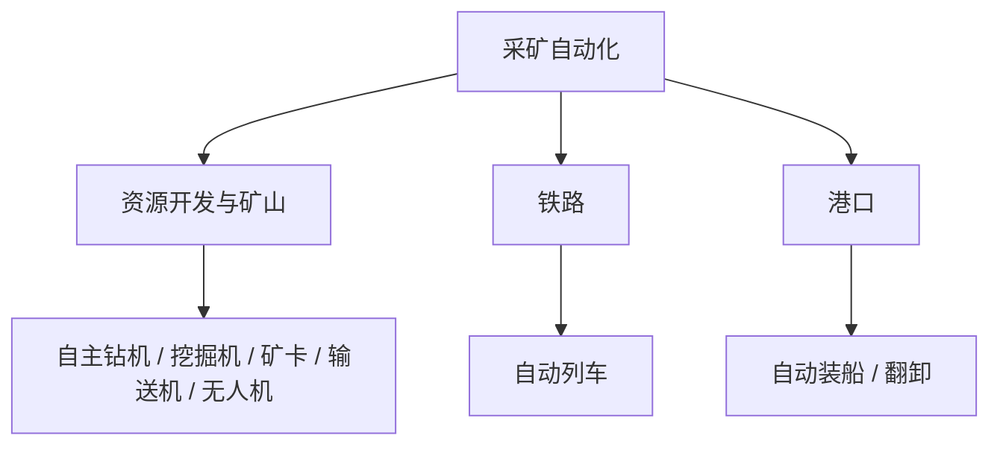
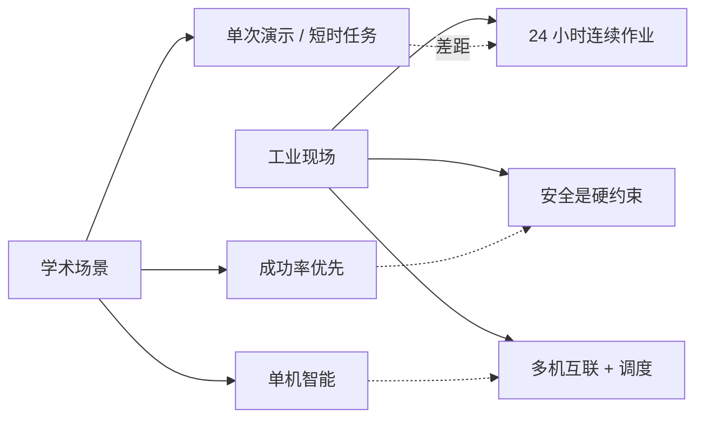

# P024 · 架构图与流程图

> 本文共 3 张图：
> **图 1 九步作业链** ／ **图 2 三大板块与平台** ／ **图 3 工业约束 vs 学术场景**
> 每张图后附：逐节点解释 → 关系 → 对应章节。
>
> 导航：[[Paper_024_MiningSurvey/01_论文精读|01 精读]] ｜ [[Paper_024_MiningSurvey/02_核心创新与方法|02 九步流程]] ｜ [[Paper_024_MiningSurvey/04_术语和公式解释|04 术语]] ｜ [[Paper_024_MiningSurvey/05_科研启发与复现建议|05 启发]]

---

## 图 1 · 九步作业链

### 1.1 逐节点解释

| 步 | 中文 | 对应平台（图 1 点名） |
|---|---|---|
| 1 | 地质评估 | 遥感/无人机（**推断**） |
| 2 | 矿山规划 | 软件（原文未在摘要说明） |
| 3 | 钻探与化验 | **自主钻机** |
| 4 | 爆破与挖掘 | **挖掘机** |
| 5 | 运输 | **自动驾驶矿卡** |
| 6 | 破碎筛分 | **输送机** |
| 7 | 堆存装车 | 输送机（**推断**） |
| 8 | 铁路 | **自动列车** |
| 9 | 翻卸 | 港口设备（图 1 提到船） |

### 1.2 数据如何流动（物料流）

矿石从地下 → 破碎 → 铁路 → 港口 → 船。**每一步都改变物料的形态与位置。**

### 1.3 关键点

**这条链是串行的**——与 P020（euROBIN 的 8 机接力）同构：**任一环故障，全链停摆**。

### 1.4 对应章节

摘要、图 2。

---

## 图 2 · 三大板块与平台

### 2.1 逐节点解释

| 板块 | 平台 |
|---|---|
| 矿山 | 钻机、挖掘机、矿卡、输送机、无人机、井下检测机器人 |
| 铁路 | 自动列车 |
| 港口 | 装船/翻卸 |

### 2.2 这张图想说明什么

自动化不是"一个机器人"，而是**三个板块、多种平台的协同**。

### 2.3 对应章节

摘要、图 1。

---

## 图 3 · 工业约束 vs 学术场景（我的整理）

### 3.1 逐节点解释

| 维度 | 学术 | 工业 |
|---|---|---|
| 时间 | 短时 | **连续** |
| 目标 | 成功率 | **安全 + 产量** |
| 范围 | 单机 | **系统** |

### 3.2 这张图想说明什么

**"走出实验室"不是把成功率从 80% 提到 90%，而是换一套约束。**

### 3.3 出处

**图 3 是我的整理**，基于原文 Foreword 对"生产率与安全"的强调，以及摘要对"large-scale interconnected systems"的表述。

---

## 四、三张图的关系

---

## 五、自检：哪些是原文有，哪些是我补的

| 元素 | 性质 |
|---|---|
| 九步流程、三大板块 | 【原文·摘要】 |
| 六类平台 | 【原文·图 1 图注】 |
| 图 3 的对照 | **【我的整理】** |
| "串行链"类比 | **【我的跨论文类比】**（与 P020 对照） |
| 各步骤的具体技术细节 | ❌ **未读** |
