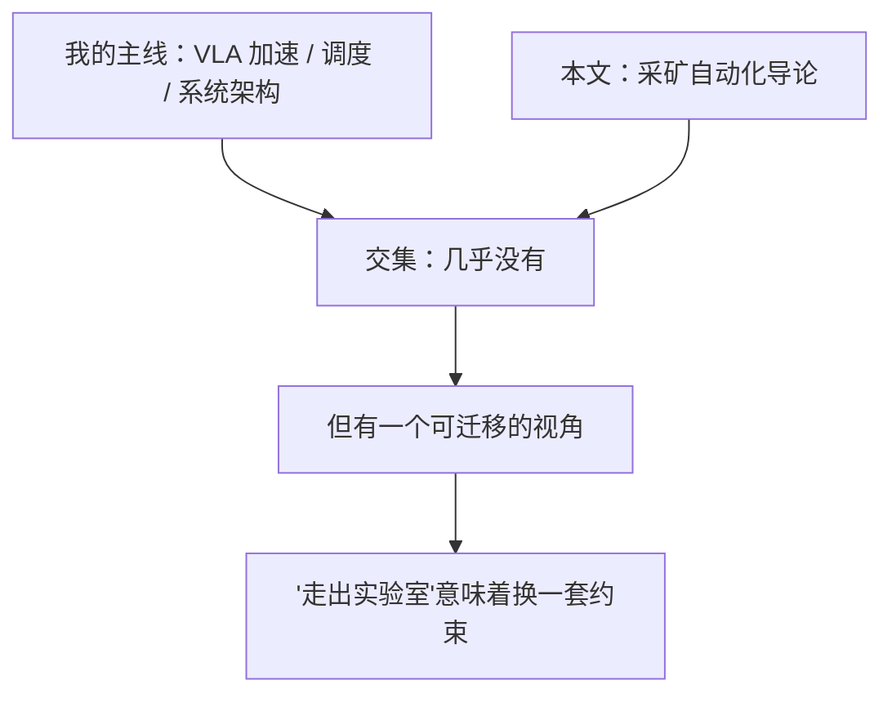

# P024 · 科研启发与复现建议

> 证据分级：**【原文证明】** / **【合理推测】** / **【待验证】**。
> 导航：[[Paper_024_MiningSurvey/01_论文精读|01 精读]] ｜ [[Paper_024_MiningSurvey/02_核心创新与方法|02 九步流程]] ｜ [[Paper_024_MiningSurvey/03_架构图与流程图|03 图]] ｜ [[Paper_024_MiningSurvey/04_术语和公式解释|04 术语]]

---

## 一、坦白说：这是 24 篇里离我方向最远的一篇

**【原文证明】**：本文不涉及 VLA、不涉及学习型策略、不涉及具身智能模型。

**【我的态度】**：不强行建立技术联系。但它给了**三个真实约束**，值得记下。

---

## 二、A–H 八问（简短）

### A. 对 VLA 推理加速的启发

**【原文证明】**：无关。
**【合理推测】**：唯一间接的启发是——**工业场景对"可用率"的要求远高于学术场景**。一个延迟 200 ms 的策略在实验室能跑，但**连续 24 小时运行 + 故障恢复**是另一回事。

### B. 对动作分块 / 执行调度的启发

**【原文证明】**：九步流程本质是一条**串行调度链**。
**【合理推测】**：与 P020（euROBIN）同构——**串行链的可靠度是各段乘积**，所以工业系统靠"冗余 + 缓冲（堆存）"来解耦。这与我在 VLA 里关心的"动作块缓冲"是同一个思想。

### C. 对量化、缓存、压缩的启发

**【原文证明】**：无。
**【合理推测】**：工业设备通常用**成熟、可验证**的技术，不会追新——这对"加速技术落地"是个提醒：**可验证性可能比先进性更重要**。

### D. 是否能用于轮式双臂机器人？

**【原文证明】**：矿卡是轮式的、挖掘机是液压臂——**"轮式 + 臂"的组合在矿山很常见**。
**【合理推测】**：这与"轮式双臂"形态相近，但**任务与精度要求完全不同**。

### E. 是否需要真实硬件？

**是**，而且是最贵的那类（矿卡、钻机）。

### F. 能否在仿真中先复现？

**【合理推测】**：可以复现**调度层**（多车协同、排队、缓冲），但复现不了**粉尘、天气、地形**。

### G. 本科阶段能否完成小规模实验？

**【我的判断】价值有限**，除非做"多机调度仿真"。

### H. 博士阶段能否进一步拓展？

一条可行的交叉：**"工业级可靠性"如何进入 VLA 的评测**（连续运行、故障恢复、长期稳定性）——这是学术论文几乎不测的维度。

---

## 三、三个我会记住的判断（我的提炼）

### 判断 1：真实场景的约束是"清单"，不是"指标"

学术论文用**成功率**一个数字概括；工业现场用**一整套约束**（连续作业、安全、粉尘、维护、互联）。

### 判断 2：自动化的第一动机常常不是"效率"，而是"安全"

原文 Foreword 明确：**减少工人暴露在职业危害中**。
→ 这提醒我：**VLA 的"安全"叙事在工业语境下会被放到第一位**。

### 判断 3：系统级可靠性靠"解耦"，不靠"更强的单机"

矿山用"堆存"做缓冲，把串行链解耦——这与我在 P020 记的"串行链可靠度是乘积"互补：**乘积不可改，但可以插入缓冲。**

---

## 四、一个具体案例：矿卡为什么要"排队等装车"（教学示例）

> [!warning] 案例性质
> 下面是**为理解"串行链 + 缓冲"构造的教学示例**，基于原文的九步流程，不是原文实验。

**场景**：4 台矿卡、1 台挖掘机、1 条输送带、1 列火车。

| 环节 | 如果不同步会发生什么 |
|---|---|
| 矿卡 → 挖掘机 | 矿卡排队等装车（挖掘机是瓶颈） |
| 挖掘机 → 输送带 | 输送带空转（等矿） |
| 输送带 → 火车 | 火车等装车（火车是瓶颈） |

**解法（工业常用）**：
- **堆存（stockpile）做缓冲**：把上游与下游解耦；
- **调度优化**：减少空转与等待。

**与 VLA 的类比**：
> 动作块就是机器人领域的"堆存"——**用一段开环执行做缓冲，把"推理"与"执行"解耦**。

---

## 五、复现路线

---

## 六、复现时会踩的坑

| 坑 | 说明 |
|---|---|
| **只读了 2 页** | 我对技术细节不了解（已标注） |
| **区域局限** | 只讲皮尔巴拉 |
| **术语门槛** | 采矿词多，需查表 |

---

## 七、与前后论文的关系

| 论文 | 关系 |
|---|---|
| [[00_文献总索引#P020 Door-to-Door Parcel Delivery]] | 都是"多机串行链"：一个在矿山，一个在城市 |
| [[00_文献总索引#P012 Cracking Mobile Manipulation]] | 都关心系统可靠性，但那篇在仿真 |
| [[00_文献总索引#P015 Anisotropic Terrain-Aware Exploration]] | 都涉及野外地形，但那篇是导航算法 |
| [[00_文献总索引#P022 Dexterous Manipulation Survey (Li)]] | 都指出"数据/现场"是瓶颈 |

---

## 八、一句话总结对我的价值

> **这是我 24 篇里最"远"的一篇，但它给了我一句我会记住的话：**
> **"走出实验室"不是把成功率从 80% 提到 90%，而是换一套约束——连续作业、硬安全、多机互联。**
> 而它和 P020（euROBIN）一起，让我看清"系统级可靠性"的两条通用规律：
> ① **串行链的可靠度是乘积**；
> ② **可靠性的解法是"插缓冲/解耦"，不是"让每一环更强"。**
